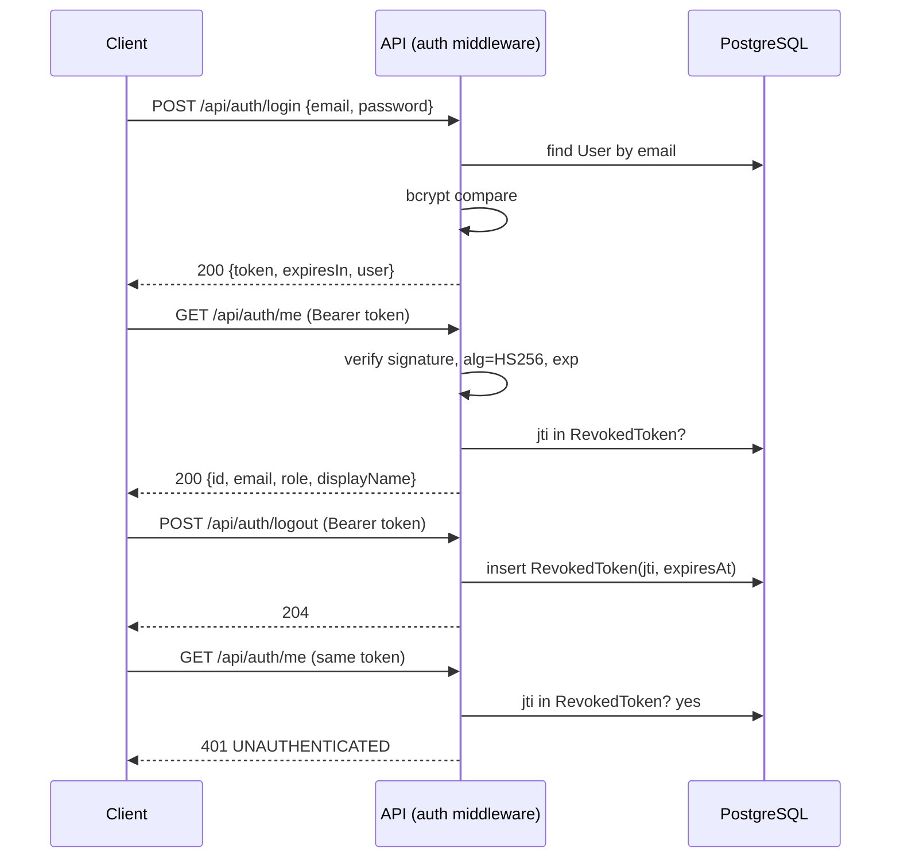

### Feature Engineering Contract: F-01 User Authentication & Server-Side Authorization
**Project Title:**  Habit and Activity Tracking System (Exercise Domain)
**Course:**  CPE 334 Software Engineering
**Feature ID:**  F-01
**Sprint:**  1
**Contract Version:**  0.3.2
**SRS Baseline Version:**  1.1.0 (Feature Inventory 1.1.0, RTM 1.1.0, System-Level SDS 1.1.0)
**Date:**  6 November 2026
**Status:**  Draft: specification-only, awaiting reviewer approval before implementation
**Primary Author:**  Nakagamon  |  **Reviewer:**  Onsinee
**Repository Path:**  `docs/sprints/sprint-1/F-01-authentication.md`

--------------------------------------------------------------------------------

#### Contract Revision History
| Version | Date | Description of Changes | Author(s) | Status |
| ------ | ------ | ------ | ------ | ------ |
| **0.1.0** | 4 Nov 2026 | Initial contract: behavior, API/data/UI specification, AC (AC-01a–f, AC-12a–c, AC-22a–c), STS, Definition of Done. Proposes new AC-01f (login input validation), not yet in RTM | Nakagamon | Draft |
| **0.1.1** | 5 Nov 2026 | Cross-review fixes against the baselines: §2 limited to the three requirements Feature Inventory 1.0.0 maps to F-01 (removed the NFR-01/NFR-04 partial rows); §3.2 completed with SDS §6.2 steps 4–5; §6 no longer cites AC-23 (its three cases are domain cases of F-04/F-05 and contain no login case); AC-12b and AC-22c restored to the exact RTM 1.0.0 wording; §7 register status aligned to the RTM §3.1 vocabulary (`INCOMPLETE` instead of an invented "stage 1 only"); §8 gains TEST-25 (AC-25, sprint-level), the SUP-01 file path and the missing e-mail length case; DoD items 7 and 9 qualified with their real evidence; §11 corrected (SRS 1.0.0 Appendix A.5 already contains `NOT_FOUND` and `INTERNAL_ERROR`), counts made provisional across contracts, and the login field-error gap recorded; R10 aligned to SDS §8 (bytes) | Nakagamon | Draft |
| **0.1.2** | 6 Nov 2026 | Baseline reconciliation (SRS / RTM / SDS / plan 1.0.0): §11 item 4 updated for the corrected proposed-AC IDs after renumbering — the Sprint 1 proposals are now AC-01f (F-01), AC-02d (F-02), AC-03d (F-03), AC-04d (F-04) and AC-06g (F-06); F-06's former "AC-06d" is restored to the RTM 1.0.0 meaning, so it is no longer a proposal. Baseline citations confirmed (RTM 1.0.0 and SDS 1.0.0 — no "RTM 1.2.0" or "SDS 0.1.0" exists in any baseline document) | Nakagamon | Draft |
| **0.3.0** | 6 Nov 2026 | Review-fix pass against baseline 1.1.0 (RTM / SDS / plan 1.1.0, SRS / Feature Inventory 1.1.0): citations updated; AC-01f is now an approved RTM 1.1.0 criterion (Tier A, Sprint 1), no longer *proposed*; §11 item 4 rewritten with the current counts (80 atomic AC, Sprint 1 = 38, Sprint 2 = 34 after CHANGE-03 … CHANGE-08) and the Coverage check no longer conditional (F-01 is verified by 12 atomic AC) Review-fix pass (PR #13): AC-01c wording aligned with RTM ("at least `{id, email, role}`"). Version 0.2.0 was intentionally skipped so that all Sprint 1 contracts share 0.3.0; no 0.2.0 content exists. | Nakagamon | Draft |
| **0.3.1** | 7 Nov 2026 | Test-path correction only: SUP-01 now names `tests/unit/env.test.ts` (the existing configuration unit test in the repo) instead of `tests/unit/config.test.ts` in §8 Files and the SUP-01 row. No change to ACs, STS cases or scope. | Nakagamon | Draft |
| **0.3.2** | 7 Nov 2026 | Password length rule measured in UTF-8 **bytes** instead of characters (§4.2, TEST-01f-2): bcrypt uses at most 72 bytes and would silently ignore the rest, so two different longer passwords could be accepted as the same one. ASCII passwords are unchanged (72 accepted / 73 rejected); only multi-byte passwords are affected. No AC, scope or other STS case changes (AC-01f already requires rejecting an over-length password). | Nakagamon | Draft |

*Rule: this file is committed as a specification-only commit before any F-01 implementation; later changes are new versions with a reason, never silent rewrites.*

--------------------------------------------------------------------------------

#### 1. Feature Summary and Scope
F-01 establishes **who the caller is and what they may do**. It provides login with seeded accounts, JWT issuance, current-user retrieval, logout with immediate revocation, and the **server-side enforcement mechanism** (authenticate → role → ownership) that every later feature uses.

| In scope | Out of scope (and where it belongs) |
| ------ | ------ |
| `POST /api/auth/login`, `GET /api/auth/me`, `POST /api/auth/logout` | Self-registration, password recovery, email verification, account administration (SRS Exclusion 4) |
| bcrypt password hashing; seeded Manager and Participant accounts | Multiple roles per account, refresh tokens |
| JWT with `jti`, 1-hour expiry; `RevokedToken` denylist in PostgreSQL | Rate limiting / lockout (recorded as a known limitation, §11) |
| Authenticate / role / ownership middleware and the declarative **route policy registry** | Business endpoints themselves (F-02, F-03, F-04 and F-06) |
| Login screen, session header, role-based landing, global 401/403 handling | Feature screens (F-02, F-03, F-04 and F-06) |
| Foundation pieces F-01 needs: `User` and `RevokedToken` tables, seed accounts, injectable Clock | Remaining schema (other features' contracts) |

--------------------------------------------------------------------------------

#### 2. Linked Requirements
| Requirement | How F-01 serves it |
| ------ | ------ |
| **FR-01** | Login, `/me`, logout, JWT lifecycle, revoked/expired token rejection, role separation |
| **BR-04** | Ownership and role enforcement so private Participant data is never exposed to other users or the Manager (401/403) |
| **NFR-02** | 401 for missing/expired/revoked tokens; 403 for wrong role or cross-user access; Endpoint Access Matrix started here and extended every sprint |

*Exactly the three requirements that Feature Inventory 1.1.0 maps to F-01 (FR-01, BR-04, NFR-02). Login latency is verified by AC-21b under SYS-01 and restart durability by AC-24a under F-04; F-01 contributes AC-01d (denylist survives a restart) to the latter without claiming the requirement.*

**Dependencies:** none upstream (Foundation: schema/migrations, seed script, Clock, test harness). **Downstream:** F-02, F-03, F-04, F-06 (Sprint 1) and all later features depend on the policy registry and middleware.

--------------------------------------------------------------------------------

#### 3. Feature Design (Feature-Level SDS)
##### 3.1 Behavior and Workflow
**Login.** Client sends email and password → server validates the body (§4.2) → finds the user by lower-cased email → compares the password with the stored bcrypt hash → on success issues a JWT and returns it with the user summary; on any credential failure returns the same 401 response.

**Authenticated request.** Client sends `Authorization: Bearer <token>` → server runs the pipeline below for every route whose policy is not `public`.

**Logout.** An authenticated request records the token's `jti` and `exp` in `RevokedToken`. From that moment any request with the same token receives 401, including after a server restart.



##### 3.2 Request Pipeline (every non-public route)
| Step | Check | Failure result |
| ------ | ------ | ------ |
| 1 Authenticate | Header present and exactly `Bearer <token>`; signature valid with `JWT_SECRET`; algorithm is HS256; `now < exp`; required claims present; `jti` not in `RevokedToken`; user in `sub` still exists | 401 `UNAUTHENTICATED` |
| 2 Role | Token `role` is in the route policy's allowed roles | 403 `FORBIDDEN` |
| 3 Ownership | For `resource-owner` routes: the record's owner equals the authenticated user; for `self-scoped` routes: a `userId` query parameter, if present, equals the authenticated user | 403 `FORBIDDEN` (404 `NOT_FOUND` only when the record does not exist) |
| 4 Hand-off | Authenticated identity `{userId, role, jti, exp}` is attached to the request for services | - |
| 5 Validate input | Body/query is validated against a schema before reaching a service; unknown fields are rejected *(SDS §6.2 step 4)* | 400 `VALIDATION_ERROR` |
| 6 Execute use case | The service layer runs the use case and its rules in a transaction *(SDS §6.2 step 5)* | Business-rule errors per SRS Appendix A.5 |

Steps 1–3 return the error envelope only; no private field is ever included in a 401/403 body. F-01 implements steps 1–4 and applies step 5 to the login body (§4.2); step 6 belongs to each feature contract.

##### 3.3 Business Rules
| ID | Rule |
| ------ | ------ |
| R1 | Passwords are stored only as bcrypt hashes; the cost comes from `BCRYPT_COST` (default 10). No plaintext in DB, logs, responses or Git |
| R2 | A JWT contains `sub` (user ID), `role`, `jti` (new UUID per login), `iat`, `exp = iat + 3600`; it is signed HS256 with `JWT_SECRET` |
| R3 | A token is valid while `now < exp` (at exactly `exp` it is expired). Time comes from the injectable Clock |
| R4 | Verification accepts **only HS256**; `alg: none` and any other algorithm are rejected |
| R5 | Unknown email and wrong password produce an identical 401 `INVALID_CREDENTIALS` response (same status, code, message); for an unknown email the server still performs a bcrypt comparison against a dummy hash to avoid revealing which emails exist by timing |
| R6 | Emails are compared case-insensitively (stored lower-case) |
| R7 | Logout revokes only the presented token; other tokens of the same user are unaffected |
| R8 | A revoked, expired, malformed or forged token is always 401, never 403 or 500 |
| R9 | Role mismatch is 403; a Manager receives no Participant activity data (BR-04) |
| R10 | The application refuses to start when `JWT_SECRET` is missing or shorter than 32 bytes (SDS §8: ≥ 32 random bytes; for an ASCII secret that is 32 characters) |
| R11 | Every route is registered with a policy (§4.5); a route without a policy cannot be registered |

##### 3.4 Failure and Boundary Cases
| Case | Expected behavior |
| ------ | ------ |
| Token expires between two requests | 401 on the first request where `now ≥ exp` |
| Token valid at 3,599 s after issue / 3,600 s after issue | Accepted / rejected |
| Token for a user that was deleted | 401 |
| Logout with an already revoked or missing token | 401 (the request never reaches the logout handler) |
| Two logins by the same user | Two independent tokens with different `jti`; revoking one leaves the other valid |
| Very long email or password | 400 before any hashing (§4.2) |
| Server restarts after logout | Revoked token still rejected (denylist in the database) |

##### 3.5 Permissions for F-01 Endpoints
| Endpoint | Unauthenticated | Manager | Participant |
| ------ | ------ | ------ | ------ |
| `POST /api/auth/login` | Allow | Allow | Allow |
| `GET /api/auth/me` | 401 | Allow | Allow |
| `POST /api/auth/logout` | 401 | Allow | Allow |

The full role/permission matrix for all features is in SDS §6.1.

--------------------------------------------------------------------------------

#### 4. API Specification
Conventions follow SDS §5.1 (JSON, error envelope from SRS Appendix A.5).

##### 4.1 `POST /api/auth/login`  (public)
Request:
```json
{ "email": "alice@exercise.test", "password": "<from seed or private handoff>" }
```
Success `200 OK`:
```json
{
  "token": "<jwt>",
  "tokenType": "Bearer",
  "expiresIn": 3600,
  "user": { "id": "uuid", "email": "alice@exercise.test", "role": "PARTICIPANT", "displayName": "Alice" }
}
```
JWT payload: `{ "sub": "uuid", "role": "PARTICIPANT", "jti": "uuid", "iat": 1793800000, "exp": 1793803600 }`.

| Status | Code | When |
| ------ | ------ | ------ |
| 200 | - | Credentials valid |
| 400 | `VALIDATION_ERROR` | Body rules in §4.2 violated; `fields` names the field and limit |
| 401 | `INVALID_CREDENTIALS` | Unknown email or wrong password (identical message, no token) |

##### 4.2 Login Input Validation
| Field | Rule |
| ------ | ------ |
| `email` | Required string, trimmed, 3–254 characters, valid email format; normalized to lower-case |
| `password` | Required string, 1–72 **bytes** when UTF-8 encoded (bcrypt processes at most 72 bytes; ASCII characters are 1 byte each, so ASCII behaves as 1–72 characters). Not trimmed |
| Body | Must be JSON; unknown fields are rejected |

##### 4.3 `GET /api/auth/me`  (any authenticated role)
Success `200 OK`: `{ "id": "uuid", "email": "…", "role": "MANAGER|PARTICIPANT", "displayName": "…" }`. Never returns `passwordHash`. Errors: 401 `UNAUTHENTICATED`.

##### 4.4 `POST /api/auth/logout`  (any authenticated role)
Success `204 No Content`; inserts `{ jti, userId, expiresAt = exp }` into `RevokedToken`; may delete rows whose `expiresAt` is in the past in the same transaction. Errors: 401 `UNAUTHENTICATED`.

##### 4.5 Route Policy Registry (contract for all features)
```ts
interface RoutePolicy {
  method: 'GET' | 'POST' | 'PUT' | 'DELETE';
  path: string;                       // e.g. '/api/entries/:id'
  featureId: string;                  // e.g. 'F-04'
  auth: 'public' | 'required';
  roles: Array<'MANAGER' | 'PARTICIPANT'>;       // empty for public routes
  ownership: 'none' | 'self-scoped' | 'resource-owner';
}
```
- `none`: any caller with an allowed role (e.g. read-only catalog).
- `self-scoped`: data is always the caller's own; a different `userId` query parameter → 403.
- `resource-owner`: a `:id` record whose owner must equal the caller (an owner-lookup function is supplied with the policy).
- The registry is the **single source** for the middleware and for the Endpoint Access Matrix tests (AC-12c, AC-22c). A completeness test fails if any route in the running application is not in the registry.
- **Test-only probe routes** (`/__test/…`, registered only when `NODE_ENV=test`): `GET /__test/manager-only` (role MANAGER), `GET /__test/participant-only` (role PARTICIPANT, self-scoped), `GET|PUT|DELETE /__test/owned/:id` (resource-owner). They let F-01 verify enforcement before real features exist, and are excluded from production builds.

--------------------------------------------------------------------------------

#### 5. Data Specification
##### 5.1 Schema (Prisma)
```prisma
enum Role { MANAGER  PARTICIPANT }

model User {
  id            String         @id @default(uuid())
  email         String         @unique          // stored lower-case
  passwordHash  String                          // bcrypt only
  role          Role
  displayName   String
  createdAt     DateTime       @default(now())
  revokedTokens RevokedToken[]
}

model RevokedToken {
  jti        String   @id
  userId     String
  user       User     @relation(fields: [userId], references: [id])
  expiresAt  DateTime
  revokedAt  DateTime @default(now())
  @@index([expiresAt])
}
```
Constraints beyond Prisma (raw SQL in the migration): `CHECK (email = lower(email))`.

##### 5.2 Migration and Seed
- Migration: `<timestamp>_auth_user_revoked_token` creates the enum and both tables; applied with `prisma migrate dev` locally and `prisma migrate deploy` in CI.
- Seed (idempotent, synthetic data, `.test` domain): 

| Email | Role | Display name | Password source |
| ------ | ------ | ------ | ------ |
| `manager@exercise.test` | MANAGER | Program Manager | `SEED_MANAGER_PASSWORD` |
| `alice@exercise.test` | PARTICIPANT | Alice | `SEED_PARTICIPANT_PASSWORD` |
| `bob@exercise.test` | PARTICIPANT | Bob | `SEED_PARTICIPANT_PASSWORD` |

Passwords are never committed; they come from environment variables or the private course handoff and are hashed with `BCRYPT_COST` when seeding.

##### 5.3 Configuration used
`JWT_SECRET` (≥ 32 bytes / 32 ASCII characters, required), `JWT_EXPIRES_IN_SECONDS` (default 3600), `BCRYPT_COST` (default 10), `APP_TIMEZONE`, `DATABASE_URL`, `DATABASE_URL_TEST`, `SEED_*_PASSWORD` (see SDS §8).

--------------------------------------------------------------------------------

#### 6. UI Specification
| Element | Behavior |
| ------ | ------ |
| **Login screen** | Fields: Email, Password (masked); button "Sign in"; Enter key submits; labels associated with inputs |
| States | *Idle*; *Submitting* (button disabled, spinner, prevents double submit); *Error* (message above the form); *Field error* (message next to the field from `fields`) |
| Messages | Credential failure: "Email or password is incorrect" (same for both causes). Empty fields are flagged before sending; server 400 messages are shown next to the field |
| After success | Token and user kept in `sessionStorage`; redirect by role: Manager → Exercise Library; Participant → Today |
| **Session header** | Shows display name and role (from `/me` on load) and a "Log out" button |
| Logout | Calls `POST /api/auth/logout`, then clears `sessionStorage` and returns to Login even if the call fails |
| **Route guards** | Unauthenticated users are redirected to Login; a role cannot open the other role's screens (UX only; the API is authoritative) |
| **Global handling** | Any 401 clears the session and shows "Please sign in again"; any 403 shows an "access denied" screen without data; 5xx shows a generic retry message |
| Data layer | No UI change is needed for `RevokedToken`; the UI never stores or displays the password |

UI behavior is verified through the Sprint 1 journey (AC-25 / TEST-25: login, role landing, logout and re-login), the API validation of AC-01f (TEST-01f-1 asserts the `fields` array the UI displays next to the field) and the DoD #9 screenshots. RTM AC-23 covers only sets 21, Quick Complete disabled on a Rest Day and editing an old entry (F-04 / F-05 cases); the login field-error display has no baseline AC — recorded in §11.

--------------------------------------------------------------------------------

#### 7. Acceptance Criteria
AC text is identical to RTM 1.1.0, which includes AC-01f (approved 6 Nov 2026, Tier A, Sprint 1). Note: the `/me` response also carries `displayName`, which AC-01c does not forbid.

| AC | Observable outcome |
| ------ | ------ |
| **AC-01a** | Login with a seeded account returns 200 and a JWT (1-hour expiry, containing `jti` and role); the response contains no password hash |
| **AC-01b** | Unknown email or wrong password returns 401 `INVALID_CREDENTIALS` with no token, using an identical message for both cases |
| **AC-01c** | `GET /api/auth/me` with a valid token returns at least `{id, email, role}` (this contract also returns `displayName`) |
| **AC-01d** | `POST /api/auth/logout` stores `jti` and `expiresAt` in `RevokedToken`; `/me` with the same token then returns 401, including after a server restart |
| **AC-01e** | Stored passwords are bcrypt hashes (prefix `$2`) and never equal the plaintext |
| **AC-01f** | Login with a missing or invalid field (missing email or password, malformed or over-length email, over-length password, non-JSON body, unknown field) returns 400 `VALIDATION_ERROR` naming the field; no token is issued and no data changes |
| **AC-22a** | Missing header, malformed Bearer, forged signature, `alg:none`, expired token, revoked token → 401 in every case |
| **AC-22b** | Valid token with the wrong role → 403 with no private data in the body |
| **AC-22c** | Endpoint Access Matrix (role dimension): for every route in the matrix, no token → 401 and wrong role → 403; a registry test fails if any registered route is missing from the matrix. The matrix grows per sprint (S1: F-01–F-04, F-06; S2: F-05, F-07, F-08, F-11; S3: F-09, F-10). |
| **AC-12a** | Manager calling any Participant log / progress / history / profile endpoint → 403 |
| **AC-12b** | Participant A using GET / PUT / DELETE on Participant B's resources (entry, plan, profile, reminder, summary) → 403; database unchanged |
| **AC-12c** | Endpoint Access Matrix (owner dimension): for every owner-scoped route in the matrix, a request by a different user → 403 |

**Two-stage verification.** AC-12a, AC-12b, AC-12c and AC-22c concern endpoints that F-02, F-03, F-04 and F-06 create later. F-01 therefore verifies them first against the `/__test/…` probe routes and its own routes (**stage 1**, at F-01 merge), and the same parametrized tests are re-run over the real routes at Sprint 1 integration (**stage 2**). The RTM register records a final PASS for these four AC **only after stage 2**; a stage-1 pass alone leaves the register at `INCOMPLETE` (stage 2 pending) — the RTM §3.1 Result vocabulary (PASS / FAIL / SKIPPED / INCOMPLETE) has no "stage 1 only" value.

--------------------------------------------------------------------------------

#### 8. Software Test Specification (STS)
Files: `tests/integration/auth.test.ts` (AC-01), `tests/integration/security_access.test.ts` (AC-12, AC-22), `tests/e2e/main_journey.spec.ts` (AC-25, sprint-level), `tests/unit/env.test.ts` (SUP-01). Fixtures: seeded users from §5.2 (`alice` and `bob` are Participants); real PostgreSQL test database; injectable Clock; test-only probe routes. "Restart" means creating a new application instance on the same database. TEST-25 spans F-01 – F-06; F-01 defines it here because no other Sprint 1 contract claims it, and it runs at Sprint 1 integration (like stage 2 of §7), not at F-01 merge.

| Test ID | AC | Level | Precondition / Input | Action | Expected result |
| ------ | ------ | ------ | ------ | ------ | ------ |
| **TEST-01a-1** | AC-01a | API/DB Integration | Alice and Manager seeded; Clock fixed at T | `POST /login` with Alice's email and correct password | 200; `token` present; decoded payload: `sub` = Alice's id, `role` = PARTICIPANT, `jti` is a UUID, `exp − iat` = 3600; `expiresIn` = 3600; `user` has id, email, role, displayName |
| TEST-01a-2 | AC-01a | API/DB Integration | Same | Login as Manager | 200; `role` = MANAGER in token and body |
| TEST-01a-3 | AC-01a | API/DB Integration | Same | Login with `ALICE@Exercise.TEST` and correct password | 200 (case-insensitive email, R6) |
| TEST-01a-4 | AC-01a | API/DB Integration | Same | Inspect the response JSON of 01a-1 for any key or value resembling `password` or a bcrypt hash | None present |
| **TEST-01b-1** | AC-01b | API/DB Integration | Unknown email `nobody@exercise.test` | Login with any password | 401, code `INVALID_CREDENTIALS`, no `token` |
| TEST-01b-2 | AC-01b | API/DB Integration | Alice seeded | Login with Alice's email and a wrong password | 401, code `INVALID_CREDENTIALS`, no `token` |
| TEST-01b-3 | AC-01b | API/DB Integration | Responses of 01b-1 and 01b-2 | Compare status, code and message | Identical |
| TEST-01b-4 | AC-01b | API/DB Integration | Email of 254 characters (valid format, unknown) and a 72-character wrong password | Login | 401 (boundary values are valid input, not 400) |
| **TEST-01c-1** | AC-01c | API/DB Integration | Alice logged in | `GET /me` with her token | 200; body equals Alice's `{id, email, role, displayName}`; no `passwordHash` |
| TEST-01c-2 | AC-01c | API/DB Integration | Manager logged in | `GET /me` | 200 with `role` = MANAGER |
| **TEST-01d-1** | AC-01d | API/DB Integration | Alice logged in (token T1, jti J1) | `POST /logout` with T1 | 204; `RevokedToken` has a row `jti = J1`, `userId` = Alice, `expiresAt` = token `exp` |
| TEST-01d-2 | AC-01d | API/DB Integration | After 01d-1 | `GET /me` with T1 | 401 `UNAUTHENTICATED` |
| TEST-01d-3 | AC-01d | API/DB Integration | After 01d-1; new application instance on the same database | `GET /me` with T1 | 401 (revocation survives restart) |
| TEST-01d-4 | AC-01d | API/DB Integration | Alice has two tokens T1 (revoked) and T2 (different jti) | `GET /me` with T2 | 200 (R7) |
| TEST-01d-5 | AC-01d | API/DB Integration | No token | `POST /logout` | 401 |
| **TEST-01e-1** | AC-01e | API/DB Integration | Seeded users | Read `passwordHash` of every seeded user directly from the database | Each matches `^\$2[aby]\$\d{2}\$` and has length 60; none equals the seed plaintext |
| TEST-01e-2 | AC-01e | API/DB Integration | Same | `bcrypt.compare(plaintext, hash)` and cost factor | True; cost equals `BCRYPT_COST` |
| **TEST-01f-1** | AC-01f | API/DB Integration | None | Login with each invalid body: missing email; missing password; `email: "ab"` (shorter than the 3-character minimum); `email: "not-an-email"`; email of 255 characters; empty password; password of 73 characters; unknown extra field; body that is not JSON | Each returns 400 `VALIDATION_ERROR`; `fields` names the offending field; no `token`; no database change |
| TEST-01f-2 | AC-01f | API/DB Integration | None | Login with a password of 72 UTF-8 bytes made of multi-byte characters (e.g. 24 Thai characters), then one of 75 bytes (25 Thai characters) | 72 bytes: not a validation error (401 for a wrong password); 75 bytes: 400 `VALIDATION_ERROR` naming `password`; no `token`; no database change |
| **TEST-22a-1** | AC-22a | Security | Route `GET /me`; no Authorization header | Request | 401 `UNAUTHENTICATED` |
| TEST-22a-2 | AC-22a | Security | Same | Header `Authorization: Basic abc`; header `Bearer` with empty token; header `Bearer a.b` | 401 each |
| TEST-22a-3 | AC-22a | Security | Token signed with a different secret | Request | 401 |
| TEST-22a-4 | AC-22a | Security | Unsigned token (`alg: none`) with a valid-looking payload; token signed HS512 with the correct secret | Request | 401 each (R4) |
| TEST-22a-5 | AC-22a | Security | Valid token issued at T; Clock set to T + 3,599 s | Request | 200 (boundary) |
| TEST-22a-6 | AC-22a | Security | Same token; Clock set to T + 3,600 s | Request | 401 (expired, R3) |
| TEST-22a-7 | AC-22a | Security | Token revoked by logout | Request | 401 |
| TEST-22a-8 | AC-22a | Security | Valid token whose user was deleted | Request | 401, not 500 |
| TEST-22a-9 | AC-22a | Security | Responses of 22a-1 to 22a-8 | Inspect bodies | Error envelope only; no private data; no database writes |
| **TEST-22b-1** | AC-22b | Security | Alice's valid token; probe `GET /__test/manager-only` | Request | 403 `FORBIDDEN`; body is the envelope only |
| TEST-22b-2 | AC-22b | Security | Manager's valid token; probe `GET /__test/participant-only` | Request | 403 `FORBIDDEN`; no data |
| **TEST-22c-1** | AC-22c | Security | Registry listing every route with its policy | For each non-public route: no token; then a token of a role not in `roles` | 401, then 403 (stage 1: F-01 routes and probes; stage 2: all Sprint 1 routes) |
| TEST-22c-2 | AC-22c | Security | Running application | Compare the application's registered routes with the registry | No route missing from the registry; a deliberately unregistered route makes the test fail (checked once with a temporary route) |
| **TEST-12a-1** | AC-12a | Security | Manager token; probe `GET /__test/participant-only` | Request | 403; no data (stage 1) |
| TEST-12a-2 | AC-12a | Security | Manager token; every `PARTICIPANT`-only route in the registry | Request | 403 for each (stage 2) |
| **TEST-12b-1** | AC-12b | Security | Probe resource owned by Bob; Alice's token | `GET`, `PUT`, `DELETE /__test/owned/:id` | 403 each; Bob's record unchanged in the database |
| TEST-12b-2 | AC-12b | Security | Same resource; Bob's token | `GET` | 200 (the control case) |
| TEST-12b-3 | AC-12b | Security | Non-existent id | `GET` | 404 `NOT_FOUND` |
| TEST-12b-4 | AC-12b | Security | Alice's token; each self-scoped route in the registry | Request with `?userId=<Bob's id>` | 403; no data (stage 2) |
| **TEST-12c-1** | AC-12c | Security | Registry; two Participants with their own records | For each `resource-owner` route: request Bob's record with Alice's token | 403 each; database unchanged (stage 1: probes; stage 2: all Sprint 1 owner-scoped routes) |
| TEST-12c-2 | AC-12c | Security | Registry | A route declared `resource-owner` without an owner-lookup function | Registration fails at startup (R11) |
| **SUP-01** *(supporting, no AC)* | R10 | Unit | `tests/unit/env.test.ts`: `JWT_SECRET` missing; ASCII `JWT_SECRET` of 31 bytes; ASCII `JWT_SECRET` of 32 bytes | Load configuration | First two fail fast with a clear error; third starts |
| **TEST-25** *(sprint-level, AC-25 shared with F-02, F-03, F-04 and F-06)* | AC-25 | UI E2E | All Sprint 1 features integrated; seeded Manager, Alice and Bob; clean database | Playwright journey in `tests/e2e/main_journey.spec.ts`: Manager creates a template → Participant logs in → selects it (3×10, weight 4) → logs 1 set / 10 reps → Quick Complete → progress 100% → logout, login again | Journey completes end-to-end and the values persist after re-login; run at Sprint 1 integration (plan §4.4), not at F-01 merge |

**Coverage check.** Every AC in §7 has at least one test; negative, boundary (3,599/3,600 s, 254/255-character email, 72/73-character password) and role cases are included. F-01 is verified by 12 atomic AC: AC-01a–f (6), AC-22a–c (3) and AC-12a–c (3). TEST-25 (AC-25) is additionally defined here as a sprint-level test and is **not** counted in the 12: AC-25 belongs jointly to F-01 – F-06 in the RTM and runs at Sprint 1 integration.

--------------------------------------------------------------------------------

#### 9. TDD Plan and Commit Sequence
Meaningful rule work is done red → green, and the failing run is retained as evidence (command, commit, output).

| Step | Commit type | Content | Evidence kept |
| ------ | ------ | ------ | ------ |
| 1 | `docs` | This contract v0.3.2 (spec-only) | Commit ID |
| 2 | `test` (red) | TEST-01a/01b/01c written; routes absent | Failing run output |
| 3 | `feat` (green) | Login and `/me`; migration and seed | Passing run output |
| 4 | `test` (red) | TEST-22a (all cases) and TEST-01d | Failing run showing e.g. `alg:none` accepted or logout not revoking |
| 5 | `feat` (green) | Authenticate middleware, algorithm pinning, denylist, Clock-based expiry | Passing run |
| 6 | `test` (red) → `feat` (green) | TEST-22b, TEST-12a/b/c and route registry with probe routes | Failing then passing runs |
| 7 | `test` / `feat` | TEST-01e, TEST-01f, SUP-01 and the login UI | Passing run |
| 8 | PR | Reviewed by Onsinee into `staging/sprint-1` | Review comment with a specific check |

--------------------------------------------------------------------------------

#### 10. Definition of Done for F-01
| # | Criterion | Evidence required |
| ------ | ------ | ------ |
| 1 | Contract reviewed and approved by Onsinee before implementation | Review comment on the contract PR; commit order |
| 2 | Login, `/me`, logout, middleware and registry implemented as specified | Code on `staging/sprint-1`; endpoints match §4 |
| 3 | Migration and seed run on a clean database | Command output from a fresh clone |
| 4 | All tests in §8 implemented and enabled (none skipped); each AC mapped | Test file names and names match the STS IDs |
| 5 | Tests executed on the merge commit with counts | Output showing passed / failed / skipped counts |
| 6 | TDD red/green evidence for AC-01d, AC-22a, AC-22b | Failing and passing runs with commit IDs |
| 7 | AC-12a/b/c and AC-22c re-run over all real Sprint 1 routes (stage 2 — completable only at Sprint 1 integration, after the F-02, F-03, F-04 and F-06 routes exist) | Integration run output; RTM register updated |
| 8 | Teammate-reviewed PR with a substantive comment; integrated on staging | PR link, reviewer, comment |
| 9 | Login UI states, role landing, logout and 401/403 handling work | Journey run (TEST-25 / AC-25) for login, role landing, logout and re-login; screenshots with version for the 401/403 UI handling (no baseline AC covers it, §11) |
| 10 | No secret committed; `.env.example` updated; README setup works | Repository check; clean-clone run |
| 11 | RTM §3.1 updated (actual test names, result, commit); changes logged | Updated register |
| 12 | Incomplete work and known limitations disclosed | §11 updated |

*Items 7 and the stage-2 part of §7 cannot be completed at F-01 merge; they are disclosed here as sprint-integration work rather than marked done early.*

--------------------------------------------------------------------------------

#### 11. Known Limitations and Open Questions
| # | Item | Position |
| ------ | ------ | ------ |
| 1 | No login rate limiting or account lockout | Out of scope for the course baseline; recorded as a known limitation and possible Sprint 3 hardening |
| 2 | Token kept in `sessionStorage` (XSS exposure) instead of an HttpOnly cookie | Accepted trade-off (SDS §12 item 4) |
| 3 | 403 for another user's existing record vs 404 for a missing one reveals that an ID exists | Required by SRS BR-04; accepted (SDS §12 item 3) |
| 4 | AC counts after the 6 Nov scope checkpoint | RTM 1.1.0 holds **80** atomic AC (28 groups): AC-01f, AC-02d, AC-03d, AC-04d and AC-06g were added to the RTM as approved criteria. At the checkpoint all 14 Tier B AC moved to Sprint 2 (CHANGE-03 … CHANGE-08), so **Sprint 1 = 38** and **Sprint 2 = 34** atomic AC. AC-01f is the only one of the five that stays in Sprint 1 (Tier A) |
| 5 | Timing-equalization behavior (R5) is a design measure, not directly asserted by a test | Verified by code review; no timing-based test, to avoid flaky tests |
| 6 | The login field-error display (§6) is not covered by any baseline AC: RTM AC-23 contains only sets 21, Quick Complete disabled on a Rest Day and editing an old entry (F-04 / F-05 cases), and Deliverable 1 §3.6 / §4.2 requires only valid/invalid login checks and login/logout screenshots | Verified in the meantime by TEST-01f-1 (the `fields` array the UI renders) and the DoD #9 screenshots; extend AC-23 or add an AC only through an approved baseline change, decided with the team |
