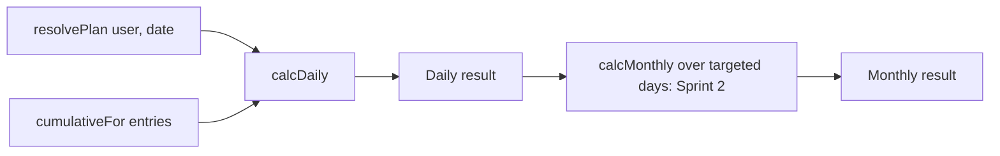

### Feature Engineering Contract: F-06 Computed Progress Display (Real-time Score & Targeted-Days-Only Average)
**Project Title:**  Habit and Activity Tracking System (Exercise Domain)
**Course:**  CPE 334 Software Engineering
**Feature ID:**  F-06
**Sprint:**  1 (calories are F-11, Sprint 2; Monthly Progress Summary is F-10, Sprint 3)
**Contract Version:**  0.3.1
**SRS Baseline Version:**  1.1.0 (Feature Inventory 1.1.0, RTM 1.1.0, System-Level SDS 1.1.0, F-01 contract 0.3.0, F-02 to F-04 contracts 0.3.0)
**Date:**  9 November 2026
**Status:**  Draft: specification-only, awaiting reviewer approval before implementation
**Primary Author:**  Nakagamon  |  **Reviewer:**  Onsinee
**Repository Path:**  `docs/sprints/sprint-1/F-06-progress-display.md`

--------------------------------------------------------------------------------

#### Contract Revision History
| Version | Date | Description of Changes | Author(s) | Status |
| ------ | ------ | ------ | ------ | ------ |
| **0.1.0** | 4 Nov 2026 | Initial contract: behavior, API/UI specification, AC (AC-06a–c, AC-15, AC-21a; proposed AC-06d), STS, Definition of Done, list of pending baseline changes (§12). No new tables | Nakagamon | Draft |
| **0.2.0** | 6 Nov 2026 | Baseline reconciliation with SRS / RTM / SDS / plan 1.0.0: baseline citations corrected (RTM 1.0.0, SDS 1.0.0 — neither "RTM 1.2.0" nor "SDS 0.1.0" exists; F-01 0.1.2, F-02–F-04 0.2.0); AC restored to the RTM 1.0.0 numbering — AC-06a–f are back to their approved meanings (item score, cap, time/distance ratio, Daily Overall %, 0%/null, load and body weight invariance), AC-15 keeps the monthly-average criterion with the RTM example, and the only genuinely new criterion (real-time, private, unaffected scores) is re-suffixed as proposed AC-06g; every test ID realigned to its AC suffix (old TEST-06b→06d/06e, old TEST-06c→15, old TEST-06d→06f/06g, plus new TEST-06b-1, TEST-06c-1); `entry source` renamed to `entry kind` to match SDS §3.2; pending item P6-8 removed because its premise was false (RTM §3 already lists AC-06a–f under Unit Testing) | Nakagamon | Draft |
| **0.3.0** | 6 Nov 2026 | Review-fix pass against baseline 1.1.0: citations updated to RTM / SDS / plan / SRS / Feature Inventory 1.1.0 (F-01 contract 0.3.0, F-02 to F-04 contracts 0.3.0); AC-06g is now an RTM 1.1.0 criterion (no longer *proposed*); AC-06g (CHANGE-08), AC-15 (CHANGE-06) and AC-21a (CHANGE-03) are marked **deferred to Sprint 2** in §1, §2, §7, §8, §9, §10 and §12 — STS rows kept; the Sprint 1 scope of F-06 is AC-06a–f; `tests/integration/progress_api.test.ts` is now listed in RTM §2 (P6-6 applied); §12 pending items given a status column | Nakagamon | Draft |
| **0.3.1** | 9 Nov 2026 | Test-row fixes only, requested by the reviewer on PR #24 (issuecomment-6741224888): `TEST-06e-3` (line 237 in 0.3.0) now requests the past date 2026-11-03 with the Clock fixed at 2026-11-05 (it requested the future date 2026-11-10, which R13, SRS Q47 and TEST-06g-4 answer with 400); `TEST-06f-1` (line 238 in 0.3.0) inserts a `WeightLog` row directly instead of calling `PUT /api/profile` (Sprint 2, CHANGE-04). No AC, API, schema or scope change. Also §9 step 1 now names v0.3.1 | Nakagamon | Draft |

*Rule: committed as a specification-only commit before any F-06 implementation; later changes are new versions with a reason, never silent rewrites.*

--------------------------------------------------------------------------------

#### 1. Feature Summary and Scope
F-06 is the **result step** of the Sprint 1 journey: after a Participant sets a goal (F-03) and logs activity (F-04), the system **computes and displays progress in real time**: the Item Score of each planned exercise (Daily Activity Score), the Daily Overall Progress (%), and the monthly average over **targeted days only**. F-06 is a **read-only computation feature**: it stores nothing and needs no migration.

| In scope | Out of scope (and where it belongs) |
| ------ | ------ |
| Ratio-based Item Score for the 6 `trackingMode` values (BR-03) | Calories, Estimated Minutes (F-11) |
| Daily Overall Progress (%) with `null` on a Rest Day | Streak and history views (F-08), including the ≥ 70% check |
| Monthly average over targeted days only (BR-07, Appendix A.3) — verified by AC-15, **deferred to Sprint 2** (CHANGE-06) | Monthly Progress Summary report (F-10, Sprint 3) |
| `GET /api/progress/daily` (Sprint 1); `GET /api/progress/monthly` is deferred to Sprint 2 (CHANGE-06) | Plan creation and resolution rule (F-03), entry rules (F-04) |
| Progress panel on the Today screen; the monthly card, `GET /api/progress/monthly` and their tests are **deferred to Sprint 2** with AC-15 (CHANGE-06) | Editing entries (F-05) |
| Pure calculation module (`progress_calc`) with unit tests | |
| Owner of AC-21a: latency check of progress and ledger endpoints (NFR-01) — **deferred to Sprint 2** (CHANGE-03) | |

--------------------------------------------------------------------------------

#### 2. Linked Requirements and Dependencies
| Requirement | How F-06 serves it |
| ------ | ------ |
| **FR-05** | Daily Activity Score, Daily Overall Progress (%), Targeted-Days-Only monthly average, displayed in real time |
| **BR-03** | Ratio formulas for the 6 modes; Daily Overall % = Σ Item Score ÷ Σ Priority Weight × 100 |
| **BR-06** (shared with F-04) | Uses direct cumulative completed values (`cumulativeFor`) |
| **BR-07** *(AC-15 deferred to Sprint 2)* | Monthly average includes targeted days only; Rest Days and future days excluded; targeted day without log counts 0% |
| Decision 11 | Body weight and `loadKg` never affect scores |
| Q23, Q24 | Daily Activity Score = Item Score; Rest Day → `null`, not 0% |
| **NFR-01** (Sprint 2 part, CHANGE-03) | p95 < 500 ms for progress and ledger endpoints under 50 concurrent requests (AC-21a, deferred to Sprint 2); the full-endpoint run is Sprint 3 |
| **BR-04 / NFR-02** (shared) | Progress is private: Manager → 403, cross-user → 403 |

**Depends on:** F-01; F-03 (`resolvePlan`, targets, `priorityWeight`); F-04 (`LedgerEntry`, `cumulativeFor`). **Downstream:** F-08 (Streak uses the same Daily Overall % and unrounded comparison), F-10, F-11.

--------------------------------------------------------------------------------

#### 3. Feature Design (Feature-Level SDS)
##### 3.1 Behavior and Workflow
1. The Today screen calls `GET /api/progress/daily` after every successful entry, so the displayed scores follow the ledger immediately (real time = recomputed on every request, no cache).
2. The server resolves the plan for the date (F-03), reads the day's entries (F-04), computes each item's ratio and score and the overall percentage, and returns them.
3. *(deferred → Sprint 2, CHANGE-06)* The Month card calls `GET /api/progress/monthly` and shows the average over targeted days with the number of days counted.
4. Rest Days show "Rest day" instead of a percentage (Sprint 1, AC-06e) and do not enter the monthly average *(deferred → Sprint 2, CHANGE-06)*.



##### 3.2 Business Rules (formulas follow SRS BR-03)
| ID | Rule | Status |
| ------ | ------ | ------ |
| R1 | Only role `PARTICIPANT` may use F-06 routes; Manager → 403. Authorization is checked before validation | Baseline (BR-04) |
| R2 | **Target value** per planned item: `WEIGHT`, `BODYWEIGHT_REPS` → `targetSets × targetRepsPerSet` (Target Total Reps); `BODYWEIGHT_TIME`, `YOGA`, `CARDIO_TIME` → `targetDurationSec`; `CARDIO_DISTANCE` → `targetDistanceKm` | Baseline BR-03 / Q21 |
| R3 | **Actual value**: Σ`totalReps`, Σ`durationSec` or Σ`distanceKm` of that exercise's entries on that date (F-04 R7). Entries of exercises that are not planned on that date are ignored for scoring | Baseline BR-06 / Q24 + SRS Q48 |
| R4 | `ratio = min(1.0, actual ÷ target)`; `itemScore = ratio × priorityWeight` (the same for all 6 modes; only the unit differs) | Baseline BR-03 |
| R5 | `Daily Overall Progress (%) = (Σ itemScore ÷ Σ priorityWeight) × 100` over the items that **occur** on the date | Baseline BR-03 |
| R6 | Rest Day (no item occurs): `overallPercent = null` (not 0) and `items = []` | Baseline Q24 |
| R7 | Targeted day with no entries: every ratio 0 and `overallPercent = 0` | Baseline BR-03 |
| R8 | Over-achievement is capped: actual above target gives ratio 1.0 | Baseline BR-03 (`min(1.0, …)`) |
| R9 | Weight load (`loadKg`), body weight and entry `kind` do not influence any score | Baseline Decision 11 |
| R10 *(deferred → Sprint 2, CHANGE-06)* | **Monthly average** for month M: take each **targeted day** (a day that is not a Rest Day) from max(first day of M, first `effectiveFrom` of the user) up to and including **today** (or the month end for a past month); average their Daily Overall % arithmetically. Future days are excluded, Rest Days are excluded, a targeted day without entries counts 0% (Appendix A.3). The current day is included with its current percentage. If there are no targeted days the average is `null` | Baseline BR-07 / A.3 + SRS Q48 |
| R11 | Percentages are returned **unrounded**; displays round half up to 1 decimal place. Calculation uses decimal arithmetic (not binary floating point) so that F-08's unrounded comparison `≥ 0.70` is exact at the boundary | Baseline Appendix A.4 + SRS Q49 + design decision |
| R12 | Scores for past dates are computed from the plan versions and entries that existed for that date (via `resolvePlan`, which picks the version by `effectiveFrom`) | Baseline B8 / BR-11 |
| R13 | (`monthly` part *(deferred → Sprint 2, CHANGE-06)*) A date must not be in the future for `daily`; a month must not be after the current month for `monthly` → 400 `VALIDATION_ERROR` | Baseline (SRS Q47) |
| R14 | F-06 is read-only: no request changes any row | Design decision |

##### 3.3 Failure and Boundary Cases
| Case | Expected behavior |
| ------ | ------ |
| Manager calls any F-06 route | 403 `FORBIDDEN` |
| No token / expired / revoked | 401 `UNAUTHENTICATED` |
| `?userId=<other>` | 403 `FORBIDDEN` |
| Actual 0 / half / equal / double the target | ratio 0 / 0.5 / 1 / 1 |
| One item with weight 3 at ratio 1.0 and one with weight 2 at ratio 0 | overall 60% |
| Two planned items, one logged and one not | Only logged item scores; the other contributes 0 and its weight stays in the denominator |
| Entry for an exercise not planned today (free-form) | Ignored in score (R3) |
| Rest Day with free-form entries | `overallPercent: null`, `items: []` |
| Plan item starting tomorrow | Not part of today's score |
| Plan item ended yesterday | Not part of today's score |
| `date` in the future / malformed (`2026-13-40`) | 400 `VALIDATION_ERROR` |
| `month` `2026-13`, `2026-11-05`, or a future month | 400 `VALIDATION_ERROR` |
| Monthly average *(deferred → Sprint 2, CHANGE-06)* with first `effectiveFrom` in the middle of the month | Days before it are not counted |
| Monthly average *(deferred → Sprint 2, CHANGE-06)* in a month with only Rest Days so far | `averagePercent: null`, `targetedDays: 0` |
| Weight changed from 40 kg to 80 kg load or body weight updated | Scores unchanged |

##### 3.4 Permissions
| Operation | Unauthenticated | Manager | Participant |
| ------ | ------ | ------ | ------ |
| `GET /api/progress/daily` (Sprint 1); `GET /api/progress/monthly` *(deferred → Sprint 2, CHANGE-06)* | 401 | 403 | Allow (own data only; `userId` query parameter other than own → 403) |

--------------------------------------------------------------------------------

#### 4. API Specification
Conventions follow SDS §5.1 (JSON, error envelope of SRS Appendix A.5, dates `YYYY-MM-DD`, month `YYYY-MM`).

##### 4.1 `GET /api/progress/daily?date=YYYY-MM-DD`  (Participant; `date` defaults to today)
Success `200 OK`:
```json
{
  "date": "2026-11-05",
  "isRestDay": false,
  "items": [
    {
      "planItemId": "uuid", "userExerciseId": "uuid", "name": "Barbell Squat",
      "trackingMode": "WEIGHT", "unit": "reps", "priorityWeight": 3,
      "target": 40, "actual": 28, "ratio": 0.7, "itemScore": 2.1
    },
    {
      "planItemId": "uuid", "userExerciseId": "uuid", "name": "Plank",
      "trackingMode": "BODYWEIGHT_TIME", "unit": "seconds", "priorityWeight": 2,
      "target": 120, "actual": 120, "ratio": 1, "itemScore": 2
    }
  ],
  "totalScore": 4.1,
  "totalWeight": 5,
  "overallPercent": 82
}
```
Rest Day: `{ "date": "...", "isRestDay": true, "items": [], "totalScore": 0, "totalWeight": 0, "overallPercent": null }`. Errors: 400, 401, 403.

##### 4.2 *(deferred → Sprint 2, CHANGE-06)* `GET /api/progress/monthly?month=YYYY-MM`  (Participant; `month` defaults to the current month)
Success `200 OK`:
```json
{
  "month": "2026-11",
  "from": "2026-11-05",
  "to": "2026-11-12",
  "targetedDays": 5,
  "restDaysExcluded": 3,
  "averagePercent": 64.3,
  "days": [
    { "date": "2026-11-05", "isRestDay": false, "overallPercent": 82 },
    { "date": "2026-11-06", "isRestDay": true, "overallPercent": null }
  ]
}
```
`from` is `max(month start, first effectiveFrom)`; `to` is today for the current month or the month end for a past month. `averagePercent` is `null` when `targetedDays` is 0. Errors: 400, 401, 403.

##### 4.3 Route Policies (registered in the F-01 registry)
Both routes: `featureId: 'F-06'`, `auth: 'required'`, `roles: ['PARTICIPANT']`, `ownership: 'self-scoped'`. F-06 has no owner-scoped (`resource-owner`) route.

##### 4.4 Internal interfaces (pure functions, no I/O)
```ts
calcItem(item: { trackingMode, target, actual, priorityWeight }): { ratio, itemScore }
calcDaily(items: ResolvedItem[], cumulative: Cumulative[]): DailyResult
calcMonthly(days: DailyResult[]): { targetedDays, restDaysExcluded, averagePercent }  // Sprint 2, CHANGE-06
```
The service layer loads data with `resolvePlan` (F-03) and `cumulativeFor` (F-04) and passes it in; the calculation functions never call the Clock or the database.

--------------------------------------------------------------------------------

#### 5. Data Specification
**No schema change and no migration.** F-06 reads `UserExercise`, `PlanItem` (F-03) and `LedgerEntry` (F-04) only. To keep the monthly endpoint (Sprint 2) within the latency target (AC-21a, Sprint 2) the service loads the user's plan items and the month's entries with two queries and computes all days in memory; it relies on the indexes `PlanItem(userId, effectiveFrom)` and `LedgerEntry(userId, logDate)` already defined in the F-03 and F-04 contracts.

**Test data.** Tests use the historical helpers of F-03 (`createHistoricalPlanItem`) and F-04 (`createHistoricalEntry`) and the injectable Clock. The latency check (AC-21a, Sprint 2, CHANGE-03) uses a documented seed dataset: 3 Participants, 8 plan items each, 30 days of entries (about 700 entries per Participant).

--------------------------------------------------------------------------------

#### 6. UI Specification
| Element | Behavior |
| ------ | ------ |
| **Progress panel** (on Today) | One row per planned exercise: name, "actual / target unit", a progress bar with the ratio (capped at 100%), and the item score ("2.1 / 3"). Below: **Daily Overall Progress** as a large percentage rounded to 1 decimal place (e.g. "82.0%") |
| Rest Day | Shows "Rest day: no goal today" instead of a percentage; no bars |
| No log yet | Bars empty and "0.0%" |
| **Month card** *(deferred → Sprint 2, CHANGE-06)* | "Monthly average (targeted days only): 64.3%" with the subtitle "5 targeted days counted, 3 rest days excluded"; "No targeted days yet" when `null` |
| Real time | The panel refetches after every successful Quick Complete or manual entry (F-04) without a page reload |
| States | Loading skeleton; error notice with retry on 5xx; `401` back to Login; `403` access-denied screen (SDS §4.2) |
| Manager | No progress screens |

UI behavior is verified through the journey (AC-25: after logging, the progress panel shows the expected percentage).

--------------------------------------------------------------------------------

#### 7. Acceptance Criteria
AC-06a–g, AC-15 and AC-21a are identical in ID and meaning to RTM 1.1.0 (refined with the concrete formulas, endpoints and limits). **Sprint 1 verifies AC-06a–f only.** **Deferred to Sprint 2 at the Fri 6 Nov checkpoint:** AC-06g (CHANGE-08), AC-15 (CHANGE-06) and AC-21a (CHANGE-03); they are specified and tested below but are outside the 38 Sprint 1 atomic AC and not required by the Sprint 1 DoD.

| AC | Observable outcome |
| ------ | ------ |
| **AC-06a** | For each of the 6 `trackingMode` values the Item Score equals `min(1, actual ÷ target) × priorityWeight` (RTM example: `WEIGHT`, target 30 reps, actual 15, Priority Weight 4 → ratio 0.5, Item Score 2.0) |
| **AC-06b** | Actual above the target is capped: RTM example — actual 45 reps against a target of 30 → ratio 1.0, i.e. the score equals the Priority Weight |
| **AC-06c** | Time-based: target 1,200 s, actual 600 s → 0.5; distance-based: target 5 km, actual 2 km → 0.4 |
| **AC-06d** | Daily Overall Progress (%) = Σ Item Score ÷ Σ Priority Weight × 100 over the items that occur on the date (RTM example: (weight 4, ratio 0.5) and (weight 1, ratio 1.0) → (2.0 + 1.0) / 5 × 100 = 60%); decimal arithmetic keeps the value exact (R11) |
| **AC-06e** | A targeted day without any log → 0%; a day with no `PlanItem` → `null` (not 0%) |
| **AC-06f** | The same reps with a different `loadKg`, or a different body weight, produce an identical score (Decision 11) |
| **AC-06g** *(deferred → Sprint 2, CHANGE-08)* | The scores returned by `GET /api/progress/daily` change immediately after a new ledger entry or Quick Complete (no stale value), are private to the owner, and are not changed by body weight, `loadKg` or entries of exercises that are not planned on that date |
| **AC-15** *(deferred → Sprint 2, CHANGE-06)* | Rest Days (and days before the first `effectiveFrom`) are excluded from the monthly average, including their free-form entries; a month with no targeted days returns `null` (RTM example: targeted days at 100%, 50% and 0% plus two Rest Days that have logs → 50% = 150 / 3) |
| **AC-21a** *(deferred → Sprint 2, CHANGE-03)* | Under a documented seed dataset, 500 requests per endpoint at concurrency 50 give p95 < 500 ms for `GET /api/progress/daily`, `GET /api/progress/monthly`, `POST /api/entries`, `POST /api/entries/quick-complete` and `GET /api/entries` (the Sprint 1 subset of NFR-01; login is measured separately at p95 < 1,000 ms and the full endpoint set is Sprint 3) |

**Shared AC with other features.** AC-14a (F-04): `cumulativeFor` is the input of AC-06. AC-12a/b/c and AC-22c (Endpoint Access Matrix): F-06 routes are covered in stage 2 (see F-01 §7); F-06 has only `self-scoped` routes. AC-25 (journey): "Verify Progress" is the last step. AC-23 is owned by F-04.

--------------------------------------------------------------------------------

#### 8. Software Test Specification (STS)
Files: `tests/unit/progress_calc.test.ts` (AC-06a–f and AC-15 unit tests), `tests/integration/progress_api.test.ts` (API tests for AC-06d, AC-06e, AC-06f, AC-06g and AC-15; new file, listed in RTM 1.1.0 §2 and §3.1), `tests/performance/latency.test.ts` (AC-21a). Fixtures: seeded Manager, Alice, Bob; plans created through F-03; entries through F-04; real PostgreSQL test database; injectable Clock fixed at **Thu 5 Nov 2026 10:00 Asia/Bangkok** unless stated. Weights and targets below are chosen so every expected value is exact.

| Test ID | AC | Level | Precondition / Input | Action | Expected result |
| ------ | ------ | ------ | ------ | ------ | ------ |
| `TEST-06a-1` | AC-06a | Unit | `calcItem`; `WEIGHT` target 40 reps, weight 3 | Actual 0, 20, 40, 80 | ratio 0, 0.5, 1, 1; itemScore 0, 1.5, 3, 3 |
| `TEST-06a-2` | AC-06a | Unit | `BODYWEIGHT_REPS` target 50, weight 2 | Actual 25, 60 | ratio 0.5, 1; score 1, 2 |
| `TEST-06a-3` | AC-06a | Unit | `BODYWEIGHT_TIME`, `YOGA`, `CARDIO_TIME`: target 120 s, 600 s, 1,800 s; weight 4 | Actual 60 s, 600 s, 2,400 s | ratio 0.5, 1, 1; score 2, 4, 4 |
| `TEST-06a-4` | AC-06a | Unit | `CARDIO_DISTANCE` target 5 km, weight 5 | Actual 1.25 km, 5 km, 7 km | ratio 0.25, 1, 1; score 1.25, 5, 5 |
| `TEST-06a-5` | AC-06a | Unit | Reps target built from 4 sets × 10 reps | Actual 28 | target 40, ratio 0.7, score 2.1 for weight 3 (decimal exact) |
| `TEST-06a-6` | AC-06a | Unit | Priority weights 1 and 5 | Same ratio | Score scales linearly with weight (1 : 5) |
| `TEST-06b-1` | AC-06b | Unit | `calcItem`; `WEIGHT` target 30 reps, weight 4 | Actual 15 and 45 | ratio 0.5 → itemScore 2.0; then ratio capped at 1.0 → itemScore 4 |
| `TEST-06c-1` | AC-06c | Unit | `calcItem`; `CARDIO_TIME` target 1,200 s and `CARDIO_DISTANCE` target 5 km | Actual 600 s and 2 km | ratio 0.5 and 0.4 |
| `TEST-06d-1` | AC-06d | Unit | `calcDaily`: item A weight 3 ratio 1.0, item B weight 2 ratio 0 | Calculate | `totalScore` 3, `totalWeight` 5, `overallPercent` 60 |
| `TEST-06d-2` | AC-06d | Unit | Three items (weights 3, 2, 5) with ratios 0.7, 1, 0.5 | Calculate | score 6.6 / 10 → 66 |
| `TEST-06d-3` | AC-06d | Unit | Items giving exactly 70% (7 of 10) and 69.99… (6.999 of 10 with decimal inputs) | Calculate | 70 exactly and < 70 (no floating-point drift, R11) |
| `TEST-06d-4` | AC-06d | API/DB Integration | Alice: Squat 4 × 10 weight 3, Plank 120 s weight 2; entries Squat 28 reps, Plank 120 s | `GET /api/progress/daily` | 200; items ratio 0.7 and 1; scores 2.1 and 2; `overallPercent` 82; `isRestDay` false |
| `TEST-06d-5` | AC-06d | API/DB Integration | Alice's plan has an item that starts tomorrow and one that ended yesterday | `GET /api/progress/daily` | Neither item appears; their weights are not in the denominator |
| `TEST-06e-1` | AC-06e | Unit | One item weight 4, no entries | Calculate | `overallPercent` 0 (targeted day without log) |
| `TEST-06e-2` | AC-06e | Unit | No planned item (Rest Day), free-form entries exist | Calculate | `isRestDay` true; `overallPercent` null; not 0 |
| `TEST-06e-3` | AC-06e | API/DB Integration | Clock fixed at 2026-11-05; Alice's plan has `effectiveFrom` 2026-11-02 and one item that does not occur on Tuesday, and nothing else | `GET /api/progress/daily?date=2026-11-03` (past Tuesday) | `isRestDay` true; `overallPercent` null; `items` empty |
| `TEST-06f-1` | AC-06f | API/DB Integration | Alice logged 20 of 40 reps; the seed gives Alice one `WeightLog` row (F-04 §5) | `GET /daily`; insert a new `WeightLog` row for Alice directly in the database (`weightKg` 120; `PUT /api/profile` is Sprint 2, CHANGE-04); `GET /daily` again | `overallPercent` unchanged (Decision 11) |
| `TEST-06f-2` | AC-06f | API/DB Integration | Same | Create a second plan with a different `loadKg` for the same template; compare ratio of the first | Ratio unchanged by `loadKg` |
| `TEST-06g-1` | AC-06g *(deferred → Sprint 2)* | API/DB Integration | Alice; Squat 4 × 10 weight 3, nothing logged | `GET /daily` (0%); `POST /api/entries/quick-complete`; `GET /daily` | 0, then 100 (no cache, same request cycle) |
| `TEST-06g-2` | AC-06g *(deferred → Sprint 2)* | API/DB Integration | Alice has a free-form entry for an exercise not planned today | `GET /daily` | The entry does not appear in `items` and does not change `overallPercent` |
| `TEST-06g-3` | AC-06g *(deferred → Sprint 2)* | API/DB Integration | Bob has his own plan and entries | `GET /daily` as Alice | Only Alice's items and percentages |
| `TEST-06g-4` | AC-06g *(deferred → Sprint 2)* | API/DB Integration | `GET /daily?date=2026-11-06` (future), `?date=2026-13-40`; `GET /monthly?month=2026-12`, `?month=2026-13`, `?month=2026-11-05` | Requests | 400 `VALIDATION_ERROR` each (R13); no rows written |
| `TEST-15-1` | AC-15 *(deferred → Sprint 2)* | Unit | `calcMonthly`: days 100, Rest Day (null), 50, Rest Day (null) | Calculate | targetedDays 2; `restDaysExcluded` 2; average 75 (not 37.5) |
| `TEST-15-2` | AC-15 *(deferred → Sprint 2)* | Unit | Only Rest Days | Calculate | `averagePercent` null; `targetedDays` 0 |
| `TEST-15-3` | AC-15 *(deferred → Sprint 2)* | API/DB Integration | Alice: Rest Day Tue 2026-11-10 with a large free-form entry; targeted days 100 and 50 | `GET /monthly` | Rest Day entry has no effect; average 75 |
| `TEST-15-4` | AC-15 *(deferred → Sprint 2)* | API/DB Integration | New Participant with no plan | `GET /monthly` | 200; `targetedDays` 0; `averagePercent` null |
| `TEST-15-5` | AC-15 *(deferred → Sprint 2)* | Unit | `calcMonthly`: days with 80, 60, 100 and an explicit 0 | Calculate | targetedDays 4; average 60 |
| `TEST-15-6` | AC-15 *(deferred → Sprint 2)* | API/DB Integration | Historical helpers: Alice targeted Mon–Fri from 2026-11-02; daily results 100 (Nov 2), 50 (Nov 3), no log (Nov 4); today is Thu 2026-11-05 with 30% | `GET /api/progress/monthly` | `from` 2026-11-02; `to` 2026-11-05; targetedDays 4; average (100 + 50 + 0 + 30) ÷ 4 = 45; future days absent from `days` |
| `TEST-15-7` | AC-15 *(deferred → Sprint 2)* | API/DB Integration | Same | Clock moved to 23:59 and then to 00:00 the next day (Fri 2026-11-06) | Thu is counted as a closed day with its final value; Fri added as a new targeted day with 0% until logged |
| `TEST-15-8` | AC-15 *(deferred → Sprint 2)* | API/DB Integration | Alice's first `effectiveFrom` is 2026-11-04 (earlier days are not part of the plan) | `GET /api/progress/monthly` | `from` 2026-11-04; Nov 1–3 not counted |
| `TEST-15-9` | AC-15 *(deferred → Sprint 2)* | API/DB Integration | Past month fixture (October, 31 days, some Rest Days) | `GET /api/progress/monthly?month=2026-10` | `to` 2026-10-31; average over targeted days of the whole month |
| `TEST-21a-1` | AC-21a *(deferred → Sprint 2)* | Performance | Seed dataset (§5): 3 Participants × 8 plan items × 30 days of entries; Alice token | 500 requests at concurrency 50 on `GET /api/progress/daily` | p95 < 500 ms; dataset size, run date and commit recorded |
| `TEST-21a-2` | AC-21a *(deferred → Sprint 2)* | Performance | Same | Same load on `GET /api/progress/monthly` | p95 < 500 ms |
| `TEST-21a-3` | AC-21a *(deferred → Sprint 2)* | Performance | Same | Same load on `GET /api/entries`, `POST /api/entries`, `POST /api/entries/quick-complete` (valid bodies, distinct exercises per request to avoid limit rejections) | p95 < 500 ms each |
| `TEST-21a-4` | AC-21a *(deferred → Sprint 2)* | Performance | Same | 500 sequential `POST /api/auth/login` at concurrency 50 | Recorded separately: p95 < 1,000 ms (SRS NFR-01) |
| `TEST-22c (F-06 routes)` | AC-22c | Security | Registry contains the 2 F-06 routes | No token; then a Manager token on each | 401; then 403 (stage 2) |
| `TEST-12a (F-06 routes)` | AC-12a | Security | Manager token | Both F-06 routes | 403 each; no data in body (stage 2) |
| `TEST-12b (F-06 routes)` | AC-12b | Security | Alice and Bob each have progress data | Alice `GET /api/progress/daily?userId=<Bob>`, `GET /api/progress/monthly?userId=<Bob>` (monthly: Sprint 2, CHANGE-06) | 403 each; no data (stage 2); Bob's own request → 200 |

**Coverage check.** Every AC in §7 has at least one test (AC-06a–f; AC-06g, AC-15 and AC-21a are deferred to Sprint 2). Boundary cases (ratio 0 / 0.5 / 1 / above 1, exact 70% without floating-point drift, midnight rollover, first `effectiveFrom` mid-month, future date/month rejected) and role/ownership cases are included. The 6 modes are all covered by unit tests; API tests use the most common modes, and the AC-25 journey exercises the real UI.

--------------------------------------------------------------------------------

#### 9. TDD Plan and Commit Sequence
| Step | Commit type | Content | Evidence kept |
| ------ | ------ | ------ | ------ |
| 1 | `docs` | This contract v0.3.1 (spec-only) | Commit ID |
| 2 | `test` (red) | TEST-06a, TEST-06b-1, TEST-06c-1, TEST-06d-1 to 06d-3, TEST-06e-1/06e-2 (unit); TEST-15-1, TEST-15-2, TEST-15-5: Sprint 2 with module absent | Failing run |
| 3 | `feat` (green) | `calcItem`, `calcDaily` (`calcMonthly`: Sprint 2) with decimal arithmetic | Passing run |
| 4 | `test` (red) | TEST-06d-4/06d-5, TEST-06e-3, TEST-06f (API); TEST-06g, TEST-15-3, TEST-15-4, TEST-15-6 to 15-9: Sprint 2 | Failing run showing e.g. Rest Day returned as 0% or future days counted |
| 5 | `feat` (green) | `GET /api/progress/daily` (`/monthly`: Sprint 2), service using `resolvePlan` and `cumulativeFor`, route policies | Passing run |
| 6 | `test` / `feat` | TEST-22c / 12a / 12b (F-06 routes), progress panel UI (month card UI: Sprint 2) | Passing run |
| 7 | `test` | *(Sprint 2, CHANGE-03)* TEST-21a latency runs on the seed dataset | Output with p95 values, dataset size and commit |
| 8 | PR | Reviewed by Onsinee into `staging/sprint-1` | Review comment with a specific check |

--------------------------------------------------------------------------------

#### 10. Definition of Done for F-06
| # | Criterion | Evidence required |
| ------ | ------ | ------ |
| 1 | Contract reviewed and approved by Onsinee before implementation | Review comment; commit order |
| 2 | Calculation module (item and daily), the daily endpoint and policies implemented as specified | Code on `staging/sprint-1`; matches §4 |
| 3 | No migration needed; indexes of F-03 and F-04 present | Schema check on a clean database |
| 4 | All Sprint 1 tests in §8 implemented and enabled (none skipped); each Sprint 1 AC mapped (TEST-06g, TEST-15-* and TEST-21a-* are Sprint 2 and are not required for Sprint 1) | Test names match STS IDs |
| 5 | Tests executed on the merge commit with counts | Passed / failed / skipped counts |
| 6 | TDD red/green evidence for AC-06d (exact 70% without drift), AC-06e (Rest Day `null`) (AC-15: Sprint 2) | Failing and passing runs with commit IDs |
| 7 | *(Sprint 2, CHANGE-03)* AC-21a latency run recorded (dataset size, p95 per endpoint, run date, commit) | Output of `latency.test.ts` |
| 8 | F-06 routes included in the Endpoint Access Matrix run at Sprint 1 integration | Integration output |
| 9 | Teammate-reviewed PR with a substantive comment; integrated on staging | PR link, reviewer, comment |
| 10 | Progress panel updates (month card: Sprint 2) in real time after logging | Journey run (AC-25); screenshots with version |
| 11 | README and test commands current; no secret committed | Clean-clone run |
| 12 | RTM §3.1 updated (actual test names, result, commit); §12 pending items resolved or logged (status column); incomplete work disclosed (§13) | Updated register |

--------------------------------------------------------------------------------

#### 11. Dependencies on Other Contracts
| Item | Provided to / needed from | Note |
| ------ | ------ | ------ |
| Registry, `requireRole`, error envelope, Clock | Needed from F-01 | F-06 cannot be merged before F-01 |
| `resolvePlan`, targets, `priorityWeight`, `UserExercise` | Needed from F-03 | Defines which items occur on a date and Rest Days |
| `LedgerEntry`, `cumulativeFor`, `createdAt` | Needed from F-04 | Source of actual values |
| `calcDaily`, `calcMonthly` (Sprint 2), unrounded percent | Provided to F-08 (Streak ≥ 70%, history), F-10 (monthly summary) | Same decimal arithmetic is reused |
| Daily result shape | Provided to F-11 | Calories are added to the daily response in Sprint 2 without changing existing fields |

--------------------------------------------------------------------------------

#### 12. Pending Baseline Impact
Status after the 6 Nov 2026 baseline pass (RTM / SDS / plan / SRS / Feature Inventory 1.1.0; see F-02 §12 for the reading of the status values). **Applied** items are in the baseline (SRS 1.1.0 Q30–Q49, RTM, SDS, plan 1.1.0); **Resolved** and **Withdrawn** items needed no baseline change. Every pending item of this contract is now applied, resolved or withdrawn.

| # | Pending item | Baseline document(s) affected | Status at baseline 1.1.0 |
| ------ | ------ | ------ | ------ |
| P6-1 | AC-06g added (RTM: +1 atomic AC; Sprint 1 count; Tier B). AC-06a–f are restored to the RTM 1.0.0 numbering, so no approved AC is dropped | RTM, sprint plan | **Applied** — RTM 1.1.0 (AC-06g; Sprint 2 by CHANGE-08), plan 1.1.0 |
| P6-2 | Concrete endpoints `GET /api/progress/daily` and `GET /api/progress/monthly` and their response shapes | SDS §5 (API) | **Applied** — SDS 1.1.0 §5.2 (progress endpoints) |
| P6-3 | Future `date` / `month` rejected with 400; reading past dates is allowed | SRS (Q17 / A.3 clarification) | **Applied** — SRS 1.1.0 Q46 and Q47 |
| P6-4 | Entries of non-planned exercises are ignored in scores (Q24 made explicit); monthly `from` uses the first `effectiveFrom` of any plan item of the user | SRS (Q24 / A.3 clarification) | **Applied** — SRS 1.1.0 Q48 |
| P6-5 | Decimal arithmetic for scores; percentages unrounded in API, rounded half up to 1 decimal in UI | SRS Appendix A.4, SDS | **Applied** — SRS 1.1.0 Q49 |
| P6-6 | Test files `tests/integration/progress_api.test.ts` (new) and the API-level rows of AC-15; RTM §2 lists only `tests/unit/progress_calc.test.ts` for AC-06 and for AC-15 | RTM §2 | **Applied** — `tests/integration/progress_api.test.ts` added to RTM 1.1.0 §2 (FR-05, BR-03, BR-07 rows; it was already the §3.1 file of AC-06g) |
| P6-7 | AC-21a defined as the Sprint 1 subset of AC-21 (progress, ledger endpoints; login separately < 1,000 ms) with a documented seed dataset | RTM, sprint plan | **Applied** — RTM 1.1.0 AC-21a / CHANGE-03 (Sprint 2); the seed-dataset wording remains in this contract |

--------------------------------------------------------------------------------

#### 13. Known Limitations and Open Questions
| # | Item | Position |
| ------ | ------ | ------ |
| 1 | The monthly endpoint recomputes all days on every request; performance relies on two queries and in-memory calculation | Acceptable for 31 days; measured by AC-21a; add caching only if the test fails |
| 2 | Today is included in the monthly average with its current (pending) percentage, so the average can move during the day | By design (Appendix A.3) |
| 3 | A Participant who changes plans mid-month (F-07, Sprint 2) is scored on the version effective for each day (R12), so past percentages stay stable | By design (BR-11) |
| 4 | Percentages as unrounded decimals may have many digits in JSON | Accepted; UI rounds for display |
| 5 | Entries of non-planned exercises are shown in the ledger (F-04) but never scored | By design (Q24) |
| 6 | Calories and Monthly Progress Summary are not shown in Sprint 1 (the monthly average card is Sprint 2) | Scheduled F-11 (Sprint 2) and F-10 (Sprint 3) |
