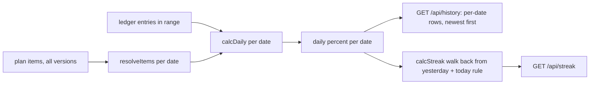

### Feature Engineering Contract: F-08 Personal History & Dynamic Streak Tracking
**Project Title:**  Habit and Activity Tracking System (Exercise Domain)
**Course:**  CPE 334 Software Engineering
**Feature ID:**  F-08
**Sprint:**  2 (the monthly summary that also shows the Streak is F-10, Sprint 3)
**Contract Version:**  0.1.1
**SRS Baseline Version:**  1.1.0 (Feature Inventory 1.1.0, RTM 1.1.10, System-Level SDS 1.1.1, Sprint Plan 1.2.0, F-03 contract 0.3.1, F-04 contract 0.3.2, F-05 contract 0.1.1, F-06 contract 0.3.1, F-07 contract 0.1.1)
**Date:**  23 November 2026
**Status:**  Draft (review-pending). Open questions are in §13; none of them is decided here
**Primary Author:**  Nakagamon  |  **Reviewer:**  Onsinee
**Repository Path:**  `docs/sprints/sprint-2/F-08-history-streak.md`

--------------------------------------------------------------------------------

#### Contract Revision History
| Version | Date | Description of Changes | Author(s) | Status |
| ------ | ------ | ------ | ------ | ------ |
| **0.1.0** | 23 Nov 2026 | Initial contract (issue #66, Part 4): behavior, API/data/UI specification, AC (AC-08a–b, AC-19a–d, wording copied from RTM 1.1.10), STS, Definition of Done, pending baseline items (§12), cross-check against the F-07 contract 0.1.0 (§11) and open questions (§13). No schema change, no migration, no change to the F-03/F-04/F-06 calculation code | Nakagamon | Draft |
| **0.1.1** | 23 Nov 2026 | Changes after Onsinee's review of PR #107 (`03e2bb5`): (1) STS fixtures runnable: `MutableClock`, log in again after moving the Clock, "n reps" = one entry of 1 set, fixture of TEST-08a-4 uses an exercise planned only on other days; (2) §13 item 9 corrected: both F-08 routes are inside AC-21b (NFR-01 p95 < 500 ms), expected cost, dataset and reporting duty stated (§12 P8-7); (3) cross-check rows 6 and 7 and the "plans all ended" case now have tests (TEST-07b-6, 07b-7, TEST-19c-6), the `/api/streak` rejection cases have a test (TEST-08a-9), and an F-05 row is added (TEST-19d-6, §11 row 11); (4) TEST-07b-2/07b-3 are added to `tests/integration/goal_reconfig.test.ts` by the F-08 PR, AC-07b is PARTIAL until then; (5) F-05 0.1.1 and F-04 0.3.2 added to header, §2 and §11; (6) AC-07b reading confirmed by the reviewer, OQ-6 closed, P8-6 added; OQ-1 and OQ-2 accepted and recorded as a pending SRS clarification (P8-6b); (7) check order of both routes (R1); a user with no plan has `days` = [today] (§4.5); a third day-row status for today at ≥ 70% (§6); the "Last 7 days" chip listed in P8-4. Not taken: the cheaper chunked walk of §4.5 (an option in her review, not a requirement) | Nakagamon | Draft |

*Rule: committed as a specification-only commit before any F-08 implementation; later changes are new versions with a reason, never silent rewrites.*

--------------------------------------------------------------------------------

#### 1. Feature Summary and Scope
F-08 gives a Participant two **read-only, derived** views of their own activity: a **history** of past days (daily percentage and recorded entries, newest first) and the current **Streak** — the number of consecutive closed targeted days whose Daily Overall Progress reached at least 70%, with Rest Days neutral and the current day "pending" (BR-10, Q19). Nothing is stored: both values are computed on every request from the plan versions in force on each date (F-03 plan resolution, F-07 versions) and the ledger entries (F-04), using the same Daily Overall % function as F-06 (SDS §3.4).

| In scope | Out of scope (and where it belongs) |
| ------ | ------ |
| `GET /api/history?from&to` (default last 30 days, newest first) (§4.1) | Daily and monthly progress endpoints (F-06); monthly average (F-06, CHANGE-06) |
| `GET /api/streak` with `todayPending` (§4.2) | Monthly Progress Summary including the Streak (F-10, Sprint 3; it will reuse `calcStreak`) |
| Pure `calcStreak` function and the history/streak service over `resolveItems` + `calcDaily` (§4.5) | Changing or deleting entries (F-05) and goals (F-07); calories (F-11) |
| History screen and Streak badge on Today and Progress (§6) | Pagination, export, charts, per-exercise history, any Manager view (BR-04, Exclusion 3) |
| Cross-check with F-07: a goal change today never rewrites past days or the closed-day Streak (§11) | Storing streak or percentages (SDS §3.4 forbids stored aggregates) |

--------------------------------------------------------------------------------

#### 2. Linked Requirements and Dependencies
| Requirement | How F-08 serves it |
| ------ | ------ |
| **FR-06** (SRS §4.1) | Participants review historical activity records and track consecutive active days; Rest Days do not affect Streaks |
| **BR-10** / Q19 / Decision 8 (SRS §4.2, §6.3) | Streak = consecutive closed targeted days with Daily Overall Progress ≥ 70% (compared unrounded), Rest Days skipped; the current day is pending and counts as soon as it reaches ≥ 70%; a closed targeted day below 70% or without any logged activity resets the Streak to 0 at midnight Asia/Bangkok |
| **BR-03 / Q49 / A.4** | Daily Overall % comes from F-06 (`calcDaily`, exact decimal arithmetic, unrounded); the ≥ 70 comparison is on the unrounded value |
| **BR-11** (F-07) | Each date is resolved with the plan version in force on that date, so a change today leaves past days and the closed-day Streak unchanged (AC-07b) |
| **BR-04 / NFR-02** | Both endpoints are Participant-only and self-scoped; Manager → 403; a foreign `userId` query parameter → 403 (SDS §5.1, §6.1) |
| SDS §2.6, Q29 | "Today" and "closed day" use the Asia/Bangkok date from the injectable Clock (AC-19d) |

**Depends on:** F-03 (`resolveItems`, plan rows), F-04 (`LedgerEntry`, `cumulativeFor`), F-05 (today's entries can be edited or deleted, so today's percentage and *T* can move), F-06 (`calcDaily`, unrounded decimal arithmetic), F-07 (plan versions; AC-07b). **Downstream:** F-10 (Streak field of the monthly summary).

--------------------------------------------------------------------------------

#### 3. Feature Design (Feature-Level SDS)
##### 3.1 Behavior and Workflow
1. Today and Progress call `GET /api/streak` and show the badge; the History screen calls `GET /api/history` for its date range and `GET /api/streak` for the same badge.
2. The server loads the user's plan items (all versions) and the ledger entries of the needed date range in two reads, then for every date applies `resolveItems(items, date)` (F-03 R12) and F-06's `calcDaily` to get that date's Daily Overall % (`null` on a Rest Day).
3. History returns one record per date of the range, newest first, with the percentage and the day's entries. Streak walks back from yesterday over the daily percentages (`calcStreak`, §3.2 R3–R7) and adds today if it has reached 70%.
4. Both are recomputed on every request (no cache, no stored value).



##### 3.2 Business Rules
| ID | Rule | Status |
| ------ | ------ | ------ |
| R1 | Only role `PARTICIPANT` may use F-08 routes; Manager → 403 on both. **Check order** (same chain as F-05 R2): 401 → 403 role → 403 foreign `userId` → 400 unknown parameter → 400 `from`/`to` validation → data. Authorization is checked before validation. Data is always the caller's own; `?userId=` other than the caller's own → 403 (the caller's own id is accepted). Query parameters other than `from`, `to` (history) and `userId` are rejected with 400 `VALIDATION_ERROR` naming the parameter (SDS §5.1). A Manager never receives Participant activity data (BR-04) | Baseline (BR-04, SDS §5.1) |
| R2 | **Closed day / pending day.** With today = the Clock's Asia/Bangkok date, a date before today is **closed**; today is **pending**; a day is evaluated as closed only after midnight Asia/Bangkok (SRS Decision 8). Future dates are never evaluated | Baseline (BR-10, Q19, SDS §2.6) |
| R3 | **Daily percentage of a date** *d* = F-06's Daily Overall Progress of *d*: `resolveItems(planItems, d)` gives the targeted items of *d* (plan version chosen by `effectiveFrom`, ties by `version`, then `endDate` and `repeatDays`), `calcDaily` scores them with that date's entries (R3–R9 of F-06). It is `null` on a Rest Day and `0` on a targeted day without entries. Entries of exercises not planned on *d*, and any entry on a Rest Day, are ignored (F-06 R3, Q24, Q48). F-08 does not reimplement scoring | Baseline (BR-03, F-06 R12) |
| R4 | **Qualifying day.** A closed targeted day qualifies iff its unrounded Daily Overall % is **≥ 70** (the value is exact: F-06 R11). Examples: items (weight 5 ratio 1.0, weight 2 ratio 1.0, weight 3 ratio 0) = 7/10 = **70% → qualifies**; (5 ratio 1.0, 2 ratio 0.99, 3 ratio 0) = 69.8% → does not (AC-19a). The displayed rounding (1 decimal, half up) never decides | Baseline (BR-10, A.4) |
| R5 | **Rest Days are neutral.** A day whose percentage is `null` neither counts nor resets; the walk skips it. Free-form entries on a Rest Day do not make it a targeted day (AC-19c, Q24). Dates before the user's first plan `effectiveFrom` are Rest Days by the same rule | Baseline (BR-10, Q24) |
| R6 | **Streak value** = *C* + *T*. *C*: starting from **yesterday** and walking back one date at a time, skip Rest Days; count each closed targeted day that qualifies; stop at the first closed targeted day that does not qualify (below 70%, or without any scored activity, which is 0%). That stop is the reset: a later run of qualifying days starts a new count. *T* = 1 if **today** is a targeted day and its percentage is ≥ 70, otherwise 0. If the user has no plan item, or no closed targeted day and today is not qualifying, the Streak is 0. The walk never goes before the user's earliest plan-item `effectiveFrom` (earlier dates are Rest Days, R5) | Baseline (BR-10, Q19) |
| R7 | **`todayPending`** is `true` iff today is a targeted day and its percentage is below 70 (it does not reset the Streak and is not yet counted); `false` if today is a Rest Day or has reached ≥ 70 (already counted). If a same-day change (a goal change, F-07; or an entry edit, F-05) moves today below 70 the day stops counting: `streak` drops by 1 and `todayPending` becomes `true` (Q19) | Baseline (BR-10, Q19) |
| R8 | **Midnight reset.** When the Clock passes midnight Asia/Bangkok, the former today becomes closed: if it is a targeted day below 70% (or without activity) the Streak becomes 0 (and the new today may add 1 once it reaches 70%); if it qualified it stays counted as a closed day. The reset happens by evaluation at request time (SRS Decision 8): no job, no stored state | Baseline (BR-10, Decision 8) |
| R9 | **Plan version by date (F-07 interaction).** History and Streak never use "the current plan": each date uses the version resolved for that date (R3). A goal change inserted today (F-07 R1, R2, R5) has `effectiveFrom` = today, so it can only change today's and later dates; every closed date resolves to the same row as before (F-07 R12) and yields the same percentage, which keeps the closed-day Streak *C* unchanged (AC-07b) | Baseline (BR-11, F-07) |
| R10 | **History range.** `from` and `to` are optional `YYYY-MM-DD` real dates; `to` defaults to today and must not be after today; `from` defaults to `to` − 29 days (so the default window is **30 calendar days including `to`**) and must not be after `to`; the range may span at most **366 days** inclusive (design decision, §13 OQ-1). Violations → 400 `VALIDATION_ERROR` naming the field. Past dates are readable (read-only), as for F-06 R13 | Baseline (SRS Q47 style) + design decision |
| R11 | **History content.** One record per date in `[from, to]`, **newest first**, including Rest Days (`isRestDay: true`, `overallPercent: null`) and targeted days without entries (`overallPercent: 0`) (§13 OQ-2). Each record carries that date's scores (`totalScore`, `totalWeight`, `overallPercent`, unrounded) and **all the user's entries of that date** ordered by `createdAt` ascending, each with `exerciseName` and `scored` (true iff the exercise is planned on that date). Entry values and `kind` are exactly those of F-04 §4.2; `userId` is never returned | Baseline (FR-06) + design decision |
| R12 | **Consistency.** For any date, `history.days[].overallPercent` equals `GET /api/progress/daily?date=` for that date, and `streak` uses the same per-date values. The Streak shown by the UI is the value of `GET /api/streak` and nothing else is computed client-side (AC-08b) | Design decision |
| R13 | F-08 is read-only: no request changes any row. Values are derived on read (SDS §3.4); nothing is cached or stored | Baseline (SDS §3.4) |
| R14 | `calcStreak` is a **pure function** (no storage, no Clock): the service passes the per-date percentages and today's date (§4.5). Tests drive it through an injected Clock and dated seed rows (SRS Q29) | Design decision |

##### 3.3 Failure and Boundary Cases
| Case | Expected behavior |
| ------ | ------ |
| Manager calls `GET /api/history` or `GET /api/streak` | 403 `FORBIDDEN`, also with invalid query parameters |
| No token / expired / revoked | 401 `UNAUTHENTICATED` |
| `?userId=<other Participant>` | 403 `FORBIDDEN`; the caller's own `userId` → 200 |
| Unknown query parameter (`foo=1`; `date=` on `/api/streak`) | 400 `VALIDATION_ERROR` naming the parameter |
| `from` after `to`; `to` after today; `from` after today (no `to`); `from`/`to` malformed (`2026-13-45`, `12/11/2026`) | 400 each, naming `from` or `to` |
| Range of 366 days inclusive / 367 days | 200 / 400 |
| No `from`, no `to` | 30 records: today and the 29 previous dates, newest first |
| Only `to` given | 30 records ending at `to` |
| Only `from` given | Records from `from` to today |
| User with no plan item and no entries | History: all records Rest Days with empty `entries`; Streak 0, `todayPending` false |
| 70% exactly / 69.8% / 69.999999999999% (unit) | Qualifies / does not / does not |
| Closed targeted day with no log | Percentage 0 → resets the Streak (AC-19b) |
| Closed targeted day whose only entries belong to an exercise not planned that day | Scored 0%, so it resets the Streak (F-06 R3) |
| Friday 100%, Saturday and Sunday Rest Days, Monday 100% | Streak 2 (AC-19c) |
| Rest Day logging on Saturday | Entry listed in history with `scored: false`; Streak unchanged |
| Today is a Rest Day | `todayPending` false; Streak is *C* only |
| Today at exactly 70% | Counts: `streak` includes today, `todayPending` false |
| Clock 23:59:59 and 00:00:00 Asia/Bangkok around a day with 50% | Streak includes the 3 earlier days then drops to 0 at midnight (AC-19d) |
| Goal changed today (F-07) | Closed dates identical before and after; only today's percentage and *T* can change (AC-07b) |
| A Participant whose plan items were all ended long ago | Every later date is a Rest Day; the Streak is unchanged by them (R5; §13 OQ-3) |

##### 3.4 Permissions
| Operation | Unauthenticated | Manager | Participant (own data) | Participant (`?userId=` other's) |
| ------ | ------ | ------ | ------ | ------ |
| `GET /api/history` | 401 | 403 | Allow | 403 |
| `GET /api/streak` | 401 | 403 | Allow | 403 |

--------------------------------------------------------------------------------

#### 4. API Specification
Conventions follow SDS §5.1 (JSON, error envelope of SRS Appendix A.5, dates `YYYY-MM-DD`, percentages unrounded JSON numbers).

##### 4.1 `GET /api/history?from=YYYY-MM-DD&to=YYYY-MM-DD`  (Participant; both optional)
Success `200 OK` (example: today 2026-11-12, `from=2026-11-10`):
```json
{
  "from": "2026-11-10",
  "to": "2026-11-12",
  "days": [
    {
      "date": "2026-11-12",
      "isRestDay": false,
      "totalScore": 2.1,
      "totalWeight": 3,
      "overallPercent": 70,
      "entries": [
        { "id": "uuid", "userExerciseId": "uuid", "exerciseName": "Barbell Squat", "logDate": "2026-11-12",
          "sets": 4, "totalReps": 28, "durationSec": null, "distanceKm": null,
          "kind": "MANUAL", "createdAt": "2026-11-12T03:00:00.000Z", "scored": true }
      ]
    },
    { "date": "2026-11-11", "isRestDay": false, "totalScore": 0, "totalWeight": 3, "overallPercent": 0, "entries": [] },
    { "date": "2026-11-10", "isRestDay": false, "totalScore": 1.5, "totalWeight": 3, "overallPercent": 50, "entries": [ { "...": "as above" } ] }
  ]
}
```
Rest Day record: `{ "date": "...", "isRestDay": true, "totalScore": 0, "totalWeight": 0, "overallPercent": null, "entries": [ ... entries with "scored": false ... ] }`. `days` always has one element per date of `[from, to]`, newest first. Errors: 400, 401, 403. The response never includes `userId`.

##### 4.2 `GET /api/streak`  (Participant; no parameters)
Success `200 OK`:
```json
{ "date": "2026-11-12", "streak": 3, "todayPending": true, "todayPercent": 0 }
```
`date` is today (Asia/Bangkok, Clock). `streak` is the integer of §3.2 R6. `todayPending` is §3.2 R7. `todayPercent` is today's unrounded Daily Overall % or `null` on a Rest Day (it lets the UI show progress toward 70% without a second call). Errors: 400 (unknown parameter), 401, 403.

##### 4.3 Error example
```json
{ "code": "VALIDATION_ERROR", "message": "from must not be after to", "fields": [{ "field": "from", "limit": "must be on or before to (2026-11-10)" }] }
```

##### 4.4 Route Policies (registered in the F-01 registry)
Both routes: `featureId: 'F-08'`, `auth: 'required'`, `roles: ['PARTICIPANT']`, `ownership: 'self-scoped'`:
`{ method: 'GET', path: '/api/history', ... }` and `{ method: 'GET', path: '/api/streak', ... }`. F-08 has no `resource-owner` route. The rows are added in the same commit as the routes so that AC-12c / AC-22c cover them (SDS §6.3).

##### 4.5 Internal interfaces (pure functions, no I/O)
```ts
type DayPercent = { date: string; overallPercent: number | null };   // null = Rest Day
calcStreak(days: readonly DayPercent[], today: string):
  { streak: number; todayPending: boolean; todayPercent: number | null }
```
`days` must contain every calendar date from its first date up to and including `today` exactly once (any order; the function sorts); a gap, a duplicate or a missing `today` throws (programming error, never an API error); dates after `today` are ignored. It implements §3.2 R2–R8 and compares `overallPercent >= 70` on the unrounded number. The service builds `days` for `[earliest plan-item effectiveFrom, today]` (for a user with no plan item: `[today]` only, a Rest Day, so `streak` 0 and `todayPending` false) with `resolveItems` (F-03 §4.7) and `calcDaily` (F-06 §4.4) on rows loaded by two reads (all plan items; entries of the range through one **read-only** `EntryRepository` range method, using the existing `LedgerEntry(userId, logDate)` index; if the issue #75 work has already added `listEntriesBetween(userId, from, to)` the F-08 PR reuses it instead of adding a second one), computing every date in memory like the F-06 monthly note. Cost: two reads and O(days × plan items) in memory, growing with the age of the plan, not with the request; a cheaper walk that stops at the first failing closed day is possible but not required. `calcDaily`'s result is exact for the terminating decimals the inputs can produce, and any non-terminating quotient is truncated (never rounded up), so a value below 70 can never reach 70.

--------------------------------------------------------------------------------

#### 5. Data Specification
**No schema change and no migration.** F-08 reads `PlanItem` (all versions), `UserExercise` and `LedgerEntry` only. Existing indexes `PlanItem(userId, effectiveFrom)` and `LedgerEntry(userId, logDate)` serve the two reads. No Streak, history or percentage column or table is added (SDS §3.4).

**Test data.** Tests use `createHistoricalPlanItem` (`tests/helpers/historicalPlan.ts`: `effectiveFrom`, `repeatDays`, `planKey`, `version`, `priorityWeight`, `endDate`; it creates reps-mode targets only), direct Prisma inserts for dated `LedgerEntry` rows (a `createHistoricalEntry` helper is named in F-06 §5 but does not exist in `tests/helpers` at the time of writing; a test may add it), and the injectable `MutableClock` (`tests/helpers/integrationApp.ts`; `FixedClock` in `server/domain/clock.ts` has no setter). Tokens expire after 3,600 s on the same Clock, so a test that moves the Clock by more than that logs in again before the next request. One helper `createHistoricalEntry` (inserting a `LedgerEntry` through Prisma) is added once by whichever of the F-07 / F-08 PRs lands first and reused by the other.

--------------------------------------------------------------------------------

#### 6. UI Specification
UI spec §5 ("Sprint 2"): "Streak badge on Today and Progress. When `todayPending`, show 'Today counts once you reach 70%'" and "History screen: date range selector, default 30 days, newest first." "Today" is always the server date (`GET /api/streak` `date`, UI spec §3.5).

| Element | Behavior |
| ------ | ------ |
| **Streak badge** (`streak-badge`) on Today (S-02) and Progress (S-06), and at the top of History | Value from `GET /api/streak` only (`streak-value`): "{n}-day streak" (n ≥ 1) or "No streak yet" for 0. When `todayPending`: the hint "Today counts once you reach 70%" (`streak-pending-hint`). The badge links to History |
| **History screen** (new route `/history`, Participant only) | Title "History"; the same badge; a range control (`history-range`): chips "Last 7 days" and "Last 30 days" (default) and two date inputs "From" and "To" (`max` = today, the server date); list newest first |
| Day row (`history-day-<YYYY-MM-DD>`) | Date, the percentage rounded to 1 decimal, half up (`history-day-percent`) or "Rest day"; a status text: "Counts toward your streak" (qualifying closed day), "Below 70%" (closed targeted day), "Today, in progress" (today below 70%), "Today, counts toward your streak" (today at ≥ 70%) |
| Day detail | Expanding a row lists its entries (`history-entries`): exercise name, value with unit, kind (`Manual` / `Quick`), time (from `createdAt`, Asia/Bangkok), and "not scored" for `scored: false` entries |
| Empty and states | Loading skeleton; "No activity in this range." when no day has entries and every day is a Rest Day; error notice with Retry; 401 back to Login; 403 access-denied screen; 400 field errors shown under the From/To inputs |
| Navigation | History is reached from the streak badge and from a "History" link on Progress. The existing Today button **"History (N)"** (completed items of today, UI spec S-02) is **not changed** by this feature; the name clash is listed in §13 OQ-4 |
| Manager | No history or streak screens; the URL redirects to the access-denied screen |

UI behavior is verified by AC-08b (§8): the History page shows the same Streak value as the API. Test ids are listed in this table.

--------------------------------------------------------------------------------

#### 7. Acceptance Criteria
AC-08a–b and AC-19a–d are identical to RTM 1.1.10 in ID and meaning; the contract only makes each one observable through a named endpoint or field. No AC is added.

| AC | Observable outcome |
| ------ | ------ |
| **AC-08a** | `GET /api/history` returns the Participant's own entries and daily % sorted newest first. *Observable:* 200 with `days[]` newest first, each with `overallPercent` and that date's own `entries`; nothing of another Participant; the values equal `GET /api/progress/daily` for the same dates |
| **AC-08b** | The UI History page shows the same Streak value as the API. *Observable:* the `streak-value` shown on `/history` equals `GET /api/streak` `.streak` for the same user and moment |
| **AC-19a** | 70% boundary: items (w=5 ratio 1.0, w=2 ratio 1.0, w=3 ratio 0) = 7/10 = 70% → counts; (w=5 ratio 1.0, w=2 ratio 0.99, w=3 ratio 0) = 69.8% → does not count. *Observable:* a closed day at exactly 70% adds 1 to `streak`; at 69.8% the Streak is 0 |
| **AC-19b** | A closed targeted day without any log → Streak = 0. *Observable:* `GET /api/streak` → `streak` 0 when the most recent closed targeted day has no entries |
| **AC-19c** | Friday 100%, Saturday and Sunday Rest Days, Monday 100% → Streak = 2. *Observable:* `streak` 2 (Rest Days neither count nor reset) |
| **AC-19d** | Yesterday's Streak = 3; today at 0% still shows 3; reaching ≥ 70% shows 4; crossing midnight without reaching 70% yields 0 (clock-controlled). *Observable:* `streak` 3 with `todayPending` true; 4 with `todayPending` false; 0 after the Clock passes midnight Asia/Bangkok |

**Shared AC with other features.** AC-07b (F-07): the Streak half is observed with F-08 (§11). AC-12a/b/c and AC-22c (Endpoint Access Matrix): both routes are covered by the generic registry tests (§4.4). AC-26a (F-10, Sprint 3) will reuse `calcStreak`.

--------------------------------------------------------------------------------

#### 8. Software Test Specification (STS)
Files: `tests/integration/streak_history.test.ts` (AC-08a, AC-19a–d; RTM path), `tests/e2e/streak_history.spec.ts` (AC-08b; RTM path). Supplementary, **not RTM-mapped**: `tests/unit/streak_calc.test.ts` (§12 P8-2). Fixtures: seeded Manager, Alice and Bob (F-01 §5.2), seeded library (F-02 §5.2), real PostgreSQL test database, injectable `MutableClock` set to **Thu 12 Nov 2026 10:00 Asia/Bangkok** unless stated (so Mon 9, Tue 10, Wed 11 Nov are closed dates; Fri 6, Sat 7, Sun 8 Nov are earlier). **Base fixture S:** Alice has one "Barbell Squat" (`WEIGHT`) plan item, version 1, `effectiveFrom` 2026-11-02, `repeatDays` every day, 4 × 10 = **40 reps**, `priorityWeight` 3. "n reps on a date" means one `LedgerEntry` of `totalReps` n for that exercise on that `logDate`, of **1 set** (`sets` 1; `LedgerEntry_sets_reps_pair_check` needs `sets` and `totalReps` together), inserted through Prisma (so 40 reps = 100%, 28 = 70%, 20 = 50%).

| Test ID | AC | Level | Precondition / Input | Action | Expected result |
| ------ | ------ | ------ | ------ | ------ | ------ |
| **TEST-08a-1** | AC-08a | API/DB Integration | Fixture S; entries: 11-09 40 reps, 11-10 20 reps, 11-12 28 reps; none on 11-11 | `GET /api/history` (no parameters) | 200; `from` 2026-10-14, `to` 2026-11-12; 30 `days`, newest first (11-12 first); 11-12 `overallPercent` 70, 11-11 0, 11-10 50, 11-09 100; dates before 2026-11-02 have `isRestDay` true, `overallPercent` null, `entries` `[]`; entries of 11-09 equal the inserted row (`exerciseName` "Barbell Squat", `scored` true); no `userId` anywhere |
| TEST-08a-2 | AC-08a | API/DB Integration | Same | `GET /api/history?from=2026-11-09&to=2026-11-11`; then `GET /api/progress/daily?date=` for each of the three dates | 3 days in the order 11-11, 11-10, 11-09; each `overallPercent`, `totalScore` and `totalWeight` equals the daily endpoint's value for that date (R12) |
| TEST-08a-3 | AC-08a | Security | Fixture S; Bob has his own plan item and entries on the same dates | Alice `GET /api/history`; Bob `GET /api/history`; Alice `GET /api/history?userId=<Bob>` and `?userId=<Alice>`; Manager `GET /api/history` (valid and invalid `from`); no token | Alice sees only her entries, Bob only his; 403; 200; 403 each; 401 |
| TEST-08a-4 | AC-08a | API/DB Integration | Alice plan item Mon–Fri `[1,2,3,4,5]` from 2026-11-02; a free-form entry on Sat 2026-11-07; on Tue 11-10 an entry of a second exercise whose plan item repeats on Mondays only (`repeatDays` `[1]`), so it exists but is not planned that day | `GET /api/history?from=2026-11-06&to=2026-11-10` | 11-07 (Sat): `isRestDay` true, `overallPercent` null, the entry present with `scored` false; 11-10: the unplanned-exercise entry listed with `scored` false and not counted in `overallPercent` |
| TEST-08a-5 | AC-08a | API/DB Integration | Two exercises planned (weights 3 and 2) with two entries each on 11-11 at different `createdAt` | `GET /api/history?from=2026-11-11&to=2026-11-11` | One day; its `entries` ordered by `createdAt` ascending; `totalWeight` 5; `overallPercent` from both items |
| TEST-08a-6 | AC-08a | API/DB Integration | Planned history: version 1 of the item effective 2026-11-02 (40 reps), version 2 (same `planKey`, `version` 2) effective 2026-11-09 (target 5 × 10 = 50); 40 reps logged on 11-08 and on 11-09 | `GET /api/history?from=2026-11-08&to=2026-11-09` | 11-08 uses the version in force that day: 100%; 11-09 uses version 2: 80% (the plan version is chosen per date, R9) |
| TEST-08a-7 | AC-08a | API/DB Integration | Fixture S, today 0 reps | `GET /api/history` (today row 0) → `POST /api/entries/quick-complete` → `GET /api/history` | Today's `overallPercent` 0 then 100 with one `QUICK_COMPLETE` entry listed (recomputed on read, R13) |
| TEST-08a-8 | AC-08a | API/DB Integration | Fixture S | `from` 2026-11-12 with `to` 2026-11-10; `to` 2026-11-13; `from` 2026-11-13 alone; `from=2026-13-45`; `to=12/11/2026`; `foo=1`; 366-day range (`from=2025-11-12&to=2026-11-12`) and 367-day range (`from=2025-11-11&to=2026-11-12`); `to=2026-11-12` alone; `from=2026-11-01` alone | 400 naming `from` or `to` (first five), 400 naming `foo`, 200 (366), 400 (367); `to` alone: 30 days ending 11-12; `from` alone: 12 days 11-01…11-12 |
| TEST-08a-9 | AC-08a | Security | Fixture S; Bob has his own item | Alice `GET /api/streak?foo=1`; Alice `GET /api/streak?date=2026-11-12`; Alice `GET /api/streak?userId=<Bob>` and `?userId=<Alice>`; Manager `GET /api/streak?foo=1`; no token | 400 naming `foo`; 400 naming `date`; 403; 200; 403 (role first); 401 |
| **TEST-08b-1** | AC-08b | UI E2E | Seeded Participant, viewport 360 × 800; dates taken from the server date (`GET /api/progress/daily` `date`) so no fake clock is needed; Prisma rows: plan every day, 100% on today−3, today−2, today−1, nothing today; the Participant logs in | Read `GET /api/streak` through the page's request context; open `/history`; read `streak-value` | The two values are equal (3), `streak-pending-hint` reads "Today counts once you reach 70%"; the list is newest first and shows the three 100% days as "Counts toward your streak" |
| TEST-08b-2 | AC-08b | UI E2E | Same | On Today press Quick Complete for the item; then open `/history` and compare again | Streak badge on Today and on History show 4 and equal `GET /api/streak` `.streak`; the pending hint is gone |
| **TEST-19a-1** | AC-19a | API/DB Integration | Three items, all every day from 2026-11-02: A weight 5 target 40 reps, B weight 2 target 100 reps (10 × 10), C weight 3 target 40 reps; yesterday (11-12 is today): 40 reps of A, 100 reps of B, none of C | `GET /api/progress/daily?date=2026-11-11`; `GET /api/streak` | Daily `overallPercent` exactly 70 (7/10); `streak` 1 (11-11 counts) and `todayPending` true (today 0%) |
| TEST-19a-2 | AC-19a | API/DB Integration | Same but 99 reps of B (ratio 0.99) | Same calls | Daily `overallPercent` 69.8; `streak` 0 (11-11 does not count) |
| TEST-19a-3 | AC-19a | API/DB Integration | Same as 19a-1 but on **today** (Clock 11-12 10:00): the same entries today | `GET /api/streak` | `streak` 1, `todayPending` false, `todayPercent` 70 (today counts at exactly 70); with 99 reps of B: `streak` 0, `todayPending` true, `todayPercent` 69.8 |
| **TEST-19b-1** | AC-19b | API/DB Integration | Fixture S; 100% on 11-09 and 11-10; **no entry at all on 11-11**; today 0 reps | `GET /api/streak` | `streak` 0 (the closed targeted day 11-11 reset it), `todayPending` true |
| TEST-19b-2 | AC-19b | API/DB Integration | Fixture S; 100% on 11-09 and 11-11; no entry on 11-10; today 0 reps | `GET /api/streak` | `streak` 1: the reset at 11-10 is not undone and the count restarts at 11-11 |
| TEST-19b-3 | AC-19b | API/DB Integration | Fixture S; 100% on 11-09 and 11-10; on 11-11 only an entry of a second exercise that is not planned that day | `GET /api/streak` | `streak` 0 (the unplanned entry is ignored, F-06 R3) |
| TEST-19b-4 | AC-19b | API/DB Integration | (i) A Participant with no plan item; (ii) Alice with her only item starting today (`effectiveFrom` 2026-11-12) | `GET /api/streak` | (i) `streak` 0, `todayPending` false, `todayPercent` null; (ii) `streak` 0, `todayPending` true |
| **TEST-19c-1** | AC-19c | API/DB Integration | Clock **Tue 10 Nov 2026 10:00**; one item Mon–Fri `[1,2,3,4,5]`, `effectiveFrom` Fri 2026-11-06, 4 × 10; 40 reps on Fri 11-06 and on Mon 11-09; nothing today | `GET /api/streak` | `streak` 2; `todayPending` true (Sat 11-07 and Sun 11-08 are Rest Days) |
| TEST-19c-2 | AC-19c | API/DB Integration | Same data; Clock **Mon 9 Nov 2026 20:00** | `GET /api/streak` | `streak` 2 and `todayPending` false (Monday is today and already at 100%) |
| TEST-19c-3 | AC-19c | API/DB Integration | Same as 19c-1 plus a free-form entry on Sat 11-07 (any exercise) | `GET /api/streak` | `streak` still 2 (Rest Day logging is neutral) |
| TEST-19c-4 | AC-19c | API/DB Integration | Same as 19c-1 but the item repeats **every day** (Saturday and Sunday are targeted days with no entries) | `GET /api/streak` | `streak` 1 (Monday counts; Sunday's 0% stopped the walk) |
| TEST-19c-5 | AC-19c | API/DB Integration | Mon–Fri item from 11-06, Fri 11-06 at 100%; Clock **Sat 7 Nov 2026 10:00** (a Rest Day) | `GET /api/streak` | `streak` 1, `todayPending` false, `todayPercent` null |
| TEST-19c-6 | AC-19c | API/DB Integration | Fixture S with 100% on 11-09, 11-10, 11-11 (`streak` 3 at 11-12), then the item is ended with `endDate` 2026-11-12 through F-07 and the Clock moves to **Thu 26 Nov** (log in again) | `GET /api/streak` | `streak` 3 and `todayPending` false: every date after the end is a Rest Day, so it neither grows nor resets (cross-check row 6) |
| **TEST-19d-1** | AC-19d | API/DB Integration | Fixture S; 100% on 11-09, 11-10, 11-11 (yesterday's Streak = 3); today 0 reps; Clock 2026-11-12 10:00 | `GET /api/streak` | `streak` 3, `todayPending` true, `todayPercent` 0 |
| TEST-19d-2 | AC-19d | API/DB Integration | Same; then today 27 reps (67.5%); then add 1 rep (28 reps, exactly 70%) | `GET /api/streak` after each | 3 with `todayPending` true; then **4** with `todayPending` false |
| TEST-19d-3 | AC-19d | API/DB Integration | Same as 19d-1 with today 20 reps (50%); Clock `2026-11-12T16:59:59Z` (23:59:59 Bangkok) | `GET /api/streak`; then set the Clock to `2026-11-12T17:00:00Z` (00:00:00 on 13 Nov Bangkok), **log in again** (the first token was issued 14 hours earlier and the 3,600 s expiry would make the second request 401) and call again; `GET /api/history?from=2026-11-12&to=2026-11-13` | First 3 (`todayPending` true); then **0** (11-12 closed at 50%), `date` 2026-11-13, `todayPending` true, `todayPercent` 0; history shows 11-12 at 50% |
| TEST-19d-4 | AC-19d | API/DB Integration | Same as 19d-1 with today 28 reps (70%); Clock 23:59:59 then 00:00:00 as in 19d-3 (log in again after moving it) | `GET /api/streak` twice | 4 with `todayPending` false; then still 4 (11-12 is now a closed qualifying day) with `todayPending` true for 11-13 |
| TEST-19d-5 | AC-19d | API/DB Integration | Fixture S with 100% on 11-09, 11-10, 11-11; Clock `2026-11-12T20:00:00Z` (03:00 on 13 Nov Bangkok, 12 Nov in UTC), Alice logs in at that Clock | `GET /api/streak` | `date` 2026-11-13; 11-12 is a closed targeted day with no entries, so `streak` 0 (Bangkok date, not UTC date) |
| TEST-19d-6 | AC-19d | API/DB Integration | Fixture S with 100% on 11-09, 11-10, 11-11; today a manual entry of 28 reps (70%, `streak` 4); F-05 is implemented | `PUT /api/entries/:id` lowering it to 20 reps, then `DELETE /api/entries/:id`; `GET /api/streak` after each | 3 with `todayPending` true after each (today's contribution moves with the entry, R7; closed days unchanged). *Runs when F-05 is merged* |
| **TEST-07b-2 / 07b-3 (F-07 cross-test, added to `tests/integration/goal_reconfig.test.ts` by the F-08 PR)** | AC-07b | API/DB Integration | As specified in F-07 §8: today 25 reps then a goal change to 50 reps; today 36 reps then a goal change to 100 reps | `GET /api/streak` before and after each `PUT /api/plan-items/:id` | 3 / `todayPending` true both times; 4 → 3 with `todayPending` true (F-07 §13 OQ-2) — the closed-day Streak never changes |
| TEST-07b-6 | AC-07b | API/DB Integration | As F-07 TEST-07b-2 (streak 3, today 25 reps) | `PUT /api/plan-items/:id` `{ "endDate": "2026-11-12" }`; `GET /api/streak` | `streak` 3 and `todayPending` true (the item still counts today; closed days unchanged). Same file as above |
| TEST-07b-7 | AC-07b | API/DB Integration | As F-07 TEST-07b-3 (today 36 reps, `streak` 4, `todayPending` false); today is Thursday | `PUT` `{ "repeatDays": [1,2,3,5,6,7] }` (today no longer targeted); `GET /api/streak` | `streak` 3, `todayPending` false, `todayPercent` null: today became a Rest Day and *T* is lost (cross-check row 7). Same file as above |
| **TEST-22c / TEST-12a / TEST-12b (F-08 routes)** | AC-22c, AC-12a–c | Security | Registry contains the two F-08 routes | Generic registry tests: no token; Manager token; `?userId=<other>` | 401; 403; 403 (stage 2) |
| *SUP-19-1 … SUP-19-6 (supplementary, `tests/unit/streak_calc.test.ts`, not an RTM test)* | AC-19a–d | Unit | `calcStreak` with hand-built `DayPercent[]` | (1) `[100,100,100]` + today 0 → 3/pending; (2) percents 70 and 69.8 and 69.999999999999 → counts / not / not; (3) Rest Days (`null`) between qualifying days are skipped; (4) a `null` today → pending false; (5) shuffled input gives the same result; (6) a gap, a duplicate date or a missing `today` throws | As listed |

**Coverage check.** Every cross-check row of §11 that says "covered" has a test row (TEST-07b-6, 07b-7, 19c-6, 19d-6). Every AC in §7 has at least one test. Negative, boundary and role/ownership cases are included (70 / 69.8 / 67.5, exactly 70% today, 366/367-day range, `from` after `to`, future `to`, Manager and foreign `userId`, no plan at all, Rest Day today, 23:59:59 / 00:00:00 Bangkok, Bangkok date vs UTC date). AC-08b depends on the F-08 UI and runs against the real app; because it cannot fix the Clock, its dates are derived from the server date (a run within a few seconds of midnight Asia/Bangkok could straddle two dates: known limitation, §13).

--------------------------------------------------------------------------------

#### 9. TDD Plan and Commit Sequence
| Step | Commit type | Content | Evidence kept |
| ------ | ------ | ------ | ------ |
| 1 | `docs` | This contract v0.1.0 (spec-only), committed before any code | Commit ID |
| 2 | `test` (red) | TEST-19a-1/2, 19b-1 … 19b-4, 19c-1 … 19c-5, 19d-1 … 19d-5 and the SUP unit cases against the missing `calcStreak` and routes | Failing run (module and route absent) |
| 3 | `feat` (green) | `calcStreak`, history/streak service, read-only `EntryRepository` range method, routes and registry rows | Passing run |
| 4 | `test` (red) → `feat` (green) | TEST-08a-1 … 08a-8 (history) | Failing then passing runs |
| 5 | `test` / `feat` | TEST-07b-2, 07b-3, 07b-6, 07b-7 (cross-tests with F-07, in `goal_reconfig.test.ts`), generic AC-22c / AC-12 runs | Passing run |
| 6 | `test` (red) → `feat` (green) | TEST-08b-1/08b-2 E2E, Streak badge and History screen | Playwright run; screenshots |
| 7 | PR | Reviewed by Onsinee into `staging/sprint-2` | Review comment with a specific check |

--------------------------------------------------------------------------------

#### 10. Definition of Done for F-08
| # | Criterion | Evidence required |
| ------ | ------ | ------ |
| 1 | Contract reviewed and approved by Onsinee before implementation | Review comment; commit order |
| 2 | `GET /api/history`, `GET /api/streak`, `calcStreak` and the two policy rows implemented as specified | Code on `staging/sprint-2`; matches §4 |
| 3 | **No migration and no schema change**; no Streak or percentage stored | `git diff` shows no change under `prisma/`; no new column or table |
| 4 | Daily % comes from `resolveItems` + `calcDaily` (no second scoring implementation); `server/domain/planResolution.ts` and `progressCalc.ts` unchanged | Diff review; TEST-08a-2 equality with the daily endpoint |
| 5 | All tests in §8 implemented and enabled (none skipped), including TEST-07b-2/07b-3/07b-6/07b-7 for F-07 (TEST-19d-6 once F-05 is merged) | Test names match STS IDs |
| 6 | Tests executed on the merge commit with counts | Passed / failed / skipped counts (integration and Playwright) |
| 7 | TDD red/green evidence for AC-19a (70% boundary), AC-19d (clock-controlled) and AC-08a | Failing and passing runs with commit IDs |
| 8 | The two routes are in the Endpoint Access Matrix run (AC-12c, AC-22c) | Integration output |
| 9 | Streak badge on Today and Progress and the History screen work as in §6 | Screenshots with the app version; TEST-08b output |
| 10 | Teammate-reviewed PR with a substantive comment; integrated on staging | PR link, reviewer, comment |
| 11 | RTM §3.1 updated (actual test names, result, commit) for AC-08a–b and AC-19a–d, and AC-07b's Streak half (AC-07b stays PARTIAL until then); register row added | Updated register |
| 12 | Open questions of §13 answered or carried forward; limitations disclosed | §13 updated |

--------------------------------------------------------------------------------

#### 11. Dependencies on Other Contracts and Cross-Check with F-07
| Item | Provided to / needed from | Note |
| ------ | ------ | ------ |
| `resolveItems`, plan rows, `planKey` / `version` / `effectiveFrom` | Needed from F-03 | Defines targeted days and Rest Days per date |
| `LedgerEntry`, entry record shape | Needed from F-04 | History entries; F-04 §4.4 already allows reading past dates |
| `calcDaily`, unrounded decimal percent | Needed from F-06 | R11 of F-06 makes the 70% comparison exact |
| New plan versions with `effectiveFrom` = today | Needed from F-07 | See the cross-check below |
| `calcStreak` and the Streak value | Provided to F-10 (Sprint 3) | Monthly summary shows the same Streak |
| Entry edit and delete (F-05, 0.1.1) | Needed from F-05 | Today's entries can change after logging, so today's percentage and *T* can move (TEST-19d-6); closed days stay read-only (F-05 R3) |
| Registry, `requireRole`, error envelope, Clock | Needed from F-01 | |

**Cross-check with the F-07 contract 0.1.1** (read in full before writing this section):
| # | F-07 rule (cited) | F-08 consequence | Result |
| ------ | ------ | ------ | ------ |
| 1 | F-07 R1/R2: a change inserts a new row with the same `planKey`, `version` + 1; no row is updated | History and Streak read all versions and pick per date (R3, R9); nothing in F-08 depends on a row being edited | Consistent |
| 2 | F-07 R5: `effectiveFrom` = today (Asia/Bangkok, Clock) | The same Clock defines "today" and "closed" in F-08 (R2); a change at 23:30 and 00:30 lands on different dates, and F-08 evaluates the same boundary (TEST-19d-3/19d-5) | Consistent |
| 3 | F-07 R8: ties between two versions with the same `effectiveFrom` are ordered by `version` | F-08 calls the same `resolveItems`, so the latest same-day version decides today's percentage | Consistent (verified in `server/domain/planResolution.ts`) |
| 4 | F-07 R12 / AC-07b: past dates keep their rows and percentages | R9: closed days and *C* are unchanged by a change today | Consistent for closed days |
| 5 | F-07 R11: today's entries are re-scored against the new target | *T* and `todayPending` can flip; F-08 R7 states it. **AC-07b says "the Streak value is unchanged"**, BR-10 / Q19 let today's contribution move | **Inconsistency between AC-07b's wording and BR-10, not between the contracts** — both contracts read AC-07b as "closed-day Streak"; carried as F-07 §13 OQ-2 and F-08 §13 OQ-6 |
| 6 | F-07 R9: End sets `endDate` = last day; after it the item no longer occurs | Days after it are Rest Days (neutral): the Streak neither grows nor resets while nothing is planned | Consistent with BR-10; note in §13 OQ-3; TEST-07b-6, TEST-19c-6 |
| 7 | F-07 R9/R4: `repeatDays` can be changed today | If today stops being a targeted day, *T* is lost and today becomes a Rest Day (same family as item 5) | Consistent; covered by R7 and TEST-07b-7 |
| 8 | F-07 §8 TEST-07b-2/07b-3 need `GET /api/streak` | The F-07 PR (#70) is merged before F-08's PR (#74) in the plan, so those two tests cannot be in the F-07 PR; they are listed in F-08 §8 and DoD #5 | **Ordering dependency**: the two tests are added to `tests/integration/goal_reconfig.test.ts` by the F-08 PR; AC-07b is PARTIAL in the RTM until F-08 is merged |
| 9 | F-07 §4.5 / F-07 R12: `planItemId` of a past date stays the old row's id | F-08 does not expose `planItemId` | Consistent |
| 10 | F-07 R10: an edit is rejected for an ended item or one that has not started | No effect on F-08 | Consistent |

--------------------------------------------------------------------------------

#### 12. Pending Baseline Impact
These items are **proposals for the lead to apply**; this contract does not edit the RTM, SDS, SRS or plan.

| # | Pending item | Baseline document(s) affected | Status |
| ------ | ------ | ------ | ------ |
| P8-1 | RTM §3.1 rows AC-08a–b, AC-19a–d: record actual test names, results and commits; AC-07b's Streak half is recorded after F-08 | RTM | Pending (implementation) |
| P8-2 | Supplementary unit file `tests/unit/streak_calc.test.ts` (SUP-19-1 … SUP-19-6) is not in RTM §2; if kept it needs an RTM note, as P6-6 did for `progress_api.test.ts` | RTM §2 | Pending review |
| P8-3 | SDS §5.2 lists `GET /api/history` and `GET /api/streak` (F-08, Sprint 2) already; the response shapes of §4 are the exact shapes the catalogue defers to the contract. No catalogue change | SDS | None needed |
| P8-4 | UI spec §2/§5: add `/history` (S-11 History, Participant, Sprint 2), the streak badge ids of §6, the chip "Last 7 days" (not in UI spec §5) and the test ids `history-day-*`, `history-range`, `history-entries` next to the existing `history-toggle` and `history-list` of the Today screen | UI spec | Pending review |
| P8-5 | Rows for F-08 in `contract-approval-register.md` | Register | Pending |
| P8-6 | RTM revision row that rewords AC-07b (same item as F-07 P7-6): the Streak counted from closed days is unchanged; today's contribution follows Q19. The reviewer confirmed the reading in her review of PR #107 | RTM | Pending (lead applies) |
| P8-6b | One-line SRS clarification (Q-style, like F-07 P7-3): the default history window is 30 calendar days including `to`, the maximum span is 366 days inclusive, and one row is returned per date including Rest Days (OQ-1, OQ-2; none of these numbers is in SRS/SDS/RTM) | SRS | Pending review |
| P8-7 | AC-21b (Sprint 3) covers `GET /api/history`, `GET /api/streak` and `PUT /api/plan-items/:id`; the implementation PR reports the p95 of the two F-08 routes when AC-21b is run, on a dataset whose plan is at least as old as the 30-day seed window | RTM / SYS-01 | Pending |

--------------------------------------------------------------------------------

#### 13. Known Limitations and Open Questions
Open questions are **not decided** by this contract; the rules marked "design decision" implement the provisional answer given here.

| # | Item | Provisional position |
| ------ | ------ | ------ |
| OQ-1 | "Default last 30 days" is read as 30 calendar days **including** today (`from` = `to` − 29), and a maximum span of 366 days is imposed (R10). Neither number is in SRS/SDS/RTM | Accepted by the reviewer; recorded as P8-6b |
| OQ-2 | History lists **every** date of the range, including Rest Days and dates before the first plan, so a default call always returns 30 records | Accepted by the reviewer (P8-6b); an alternative is to omit Rest Days without entries |
| OQ-3 | The Streak does not change while the user has no targeted days (all items ended or not started), so an old Streak can stay displayed indefinitely. That is what BR-10 ("Rest Days do not reset Streak") says literally | Implemented literally; confirm that no inactivity limit is wanted |
| OQ-4 | **Name clash in the UI:** Sprint 1 Today already has a button "History (N)" that shows today's *completed items* (UI spec S-02), while F-08 adds a multi-day History screen | F-08 leaves the existing button unchanged and reaches the new screen from the streak badge and Progress (§6); the UI spec owners may prefer renaming one of them |
| OQ-5 | The status text "Below 70%" is based on the unrounded value, so 69.96% displays as "70.0%" (rounded half up to 1 decimal) next to "Below 70%" | Accepted per A.4 (comparison unrounded, display rounded); a 2-decimal display is an alternative |
| OQ-6 | **AC-07b vs BR-10:** "the Streak value is unchanged" after a goal change today, but today's pending contribution can change (R7). Same question as F-07 §13 OQ-2 | Both contracts read it as "the closed-day Streak is unchanged"; the author (Nakagamon) agreed on 23 Nov 2026 and the reviewer (Onsinee) confirmed it in her review of PR #107. **Closed**; the wording of AC-07b is clarified by P8-6 (a revision row) |
| OQ-7 | `todayPercent` in the `GET /api/streak` response is an addition of this contract (SDS and RTM name only `todayPending`) | Provisional, harmless to remove |
| 8 | AC-08b (E2E) cannot fix the Clock; its dates are derived from the server date, so a run within seconds of midnight Asia/Bangkok may straddle two dates | Run away from midnight; the clock-controlled behavior is covered by the integration tests (AC-19d) |
| 9 | **Latency (NFR-01).** SRS NFR-01 says all protected endpoints respond with p95 < 500 ms and AC-21b (Sprint 3) is "all protected endpoints ... p95 < 500 ms each", so `GET /api/history`, `GET /api/streak` and F-07's `PUT /api/plan-items/:id` are inside AC-21b; AC-21a (progress and ledger endpoints) covers none of them. `GET /api/streak` is called on every Today and Progress load and, per §4.5, reads plan items and entries from the earliest `effectiveFrom` to today (two reads, O(days × plan items) in memory), so its cost grows with the age of the plan | The AC-21b dataset must contain, for F-08, a plan at least as old as the 30-day seed window; the implementation PR reports the p95 of both F-08 routes when AC-21b is run (P8-7); a cheaper walk that stops at the first failing closed day is an option, not a requirement |
| 10 | Test helper `createHistoricalPlanItem` creates reps-mode targets only (`tests/helpers/historicalPlan.ts`); the STS therefore uses `WEIGHT` items | F-08 uses `WEIGHT` items only; F-07 creates other modes through `POST /api/plan-items` (F-07 §5) |
